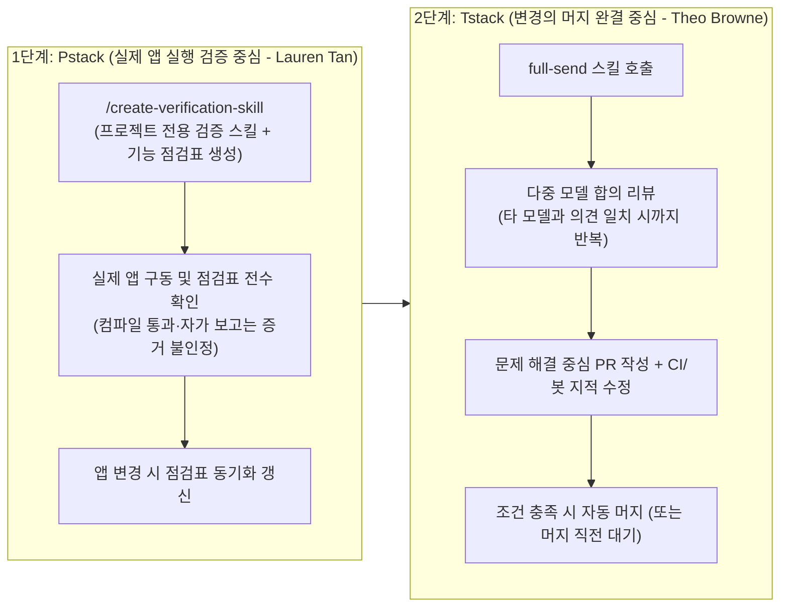

# Pstack · Tstack · Plandex · Pullboard: 코딩 에이전트 검증 우선 워크플로 및 누적 Diff 샌드박스

## 1. 핵심 요약 (Executive Summary)
동일한 프런티어 LLM을 사용하더라도 코딩 에이전트의 첫 출력을 그대로 수용하는지, 아니면 **일하는 순서(Workflow) 안에 실행 검증·교차 모델 합의·누적 Diff 격리**를 강제하는지에 따라 엔지니어링 품질이 극단적으로 갈린다. 본 문서는 최신 코딩 에이전트 실행 규율을 대표하는 4대 오픈소스 아키텍처(**Pstack**, **Tstack**, **Plandex**, **Pullboard**)를 종합한다.

---

## 2. `Pstack` & `Tstack`: 검증(Verification)과 완결(Full-Send)의 스킬 체이닝

### 2.1 `Pstack` (Lauren Tan / SpaceXAI, 전 Meta React Compiler 제작자)
구현(Implementation)보다 **실제 애플리케이션 실행 검증(Verification)**에 무게를 둔 엔지니어링 스킬 모음이다.
- **핵심 스킬 `/create-verification-skill`**: 프로젝트마다 전용 검증 스킬과 **기능 점검표(Feature Verification Checklist)**를 생성한다. 점검표에는 각 기능을 어떻게 실행하고 어떤 상태를 확인해야 하는지 명시된다.
- **증거 인정 기준**: 컴파일 성공, 정적 분석(Linter/Typecheck) 통과, 에이전트의 *"다 됐습니다"*라는 텍스트 보고는 완료 증거로 인정하지 않는다. 반드시 점검표대로 **실제 앱을 띄워 동작을 확인**해야 한다.
- **살아있는 점검표(Living Checklist)**: 앱 기능이 바뀌어 점검표와 실제 앱이 어긋나면 전용 관리 스킬로 점검표를 함께 갱신한다.

### 2.2 `Tstack` (Theo Browne / T3 Code)
작은 단위 스킬들을 체이닝하여 **단일 변경사항을 PR부터 머지까지 완결**하는 워크플로 스킬 모음이다.
- **핵심 오케스트레이터 스킬 `full-send`**: 에이전트에게 `full send`를 지시하면 단일 거대 프롬프트로 처리하는 대신, **동작 확인 → 교차 리뷰 → PR 작성 → CI 대응**을 맡은 하위 스킬들을 순차 호출한다.
- **교차 모델 합의 리뷰(Cross-Model Consensus Review)**: 리뷰 단계에서 **서로 다른 모델(예: Claude와 Codex/GPT)의 의견이 완전히 일치할 때까지 코드 리뷰와 수정을 반복**한다. 직접 최종 머지를 승인하고 싶다면 머지 직전에 멈추는 변형 스킬을 사용한다.
- **커스터마이징 원칙**: 타인이 만든 스택을 그대로 쓰는 데 그치지 않고, 자신의 저장소 `AGENTS.md`와 개발 규율에 맞게 고쳐 쓸 때 장기적인 생산성 자산이 된다.

---

## 3. `Plandex` & `Pullboard`: 대규모 프로젝트 누적 Diff 샌드박스와 독립 심판 에이전트

### 3.1 `Plandex`: 대규모 멀티파일 프로젝트용 누적 Diff 리뷰 샌드박스
파일이 너무 커서 전체 로드가 불가능하거나 수십 개 파일에 변경이 걸치는 대규모 프로젝트 전용 코딩 에이전트(MIT 라이선스, Docker 셀프호스팅 1줄 설치)다.
- **누적 Diff 리뷰 샌드박스(Cumulative Diff Review Sandbox)**: AI가 생성한 모든 코드 변경을 실제 워킹 디렉터리와 완전히 분리된 샌드박스에 누적한다. 개발자가 검토·수정·승인하기 전까지는 실제 프로젝트 파일을 절대 건드리지 않으며 언제든 즉시 롤백할 수 있다.
- **2M 토큰 유효 컨텍스트 & Tree-sitter 프로젝트 맵**: 30개 이상 언어를 지원하는 **Tree-sitter** 기반 고속 프로젝트 맵으로 전체 코드베이스 구조를 파악하고, 각 스텝에 필요한 파일만 동적으로 로드하여 **200만(2M) 토큰 유효 컨텍스트**를 운용한다.
- **플랜 버전 관리 및 브랜칭**: 계획(Plan)의 모든 업데이트를 버전 관리하며, 여러 구현 경로를 브랜치(Branch)로 분기해 탐색하고 터미널 빌드·린터·테스트·배포 에러를 자동 디버깅한다.

### 3.2 `Pullboard`: 병렬 에이전트 레인과 독립 검증 심판(Referee)
- **"절대 단일 에이전트를 신뢰하지 마라"**: 사전 승인된 명세(Spec)를 바탕으로 여러 코딩 에이전트를 각자의 격리된 레인(Lane)에서 병렬로 실행한다.
- **독립 검증 에이전트 게이트**: 첫 번째 에이전트가 작성한 코드는 **두 번째 에이전트가 승인된 명세(Spec)에 맞는지 독립적으로 검증(Verify)하기 전까지 절대 배포(Ship)되지 않는다**. `Pullboard` 자체는 직접 LLM을 호출하지 않고 로컬 Git 저장소 안에서 기존 에이전트들 사이의 심판(Referee) 역할만 수행한다.

---

## 4. 관련 문서 (Cross-References)
- [[wiki/Engineering/AI-Native-Engineering/Devin-OpenHands-Plandex-Update-2026-04-09.md]]
- [[wiki/Agents/Self-Evolving/Harness-Squared-Recursive-Agent-Harnessing.md]]
- [[wiki/Engineering/AI-Native-Engineering/Agentic-Software-Factory.md]]
- [[wiki/Engineering/AI-Native-Engineering/Epistemic-Debt-ChangeScore-Friction-Gate.md]]
- [[wiki/Agents/Coding-and-Engineering/000_Coding-and-Engineering-MOC.md]]
