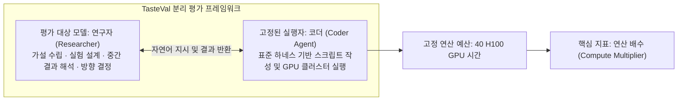

# TasteVal: AI 연구 직관(Research Taste) 및 과학적 탐구력 측정 벤치마크

## 1. 개요 및 패러다임 전환

과학적 발견(Scientific Discovery)과 AI R&D의 역사에서 위대한 성과는 단지 코드를 빠르게 작성하거나 실험을 무작정 병렬 실행하는 능력에서만 나오지 않았다. 무수한 가설과 가능한 실험 조합 중에서:
1. **어떤 문제에 집중하고 가설을 세울 것인가**,
2. **어떤 실험을 설계하여 핵심 변인을 통제할 것인가**,
3. **도출된 중간 결과로부터 무엇을 해석하고 다음 시도로 피벗할 것인가**

를 결정하는 판단력, 즉 **‘연구 직관(Research Taste)’**이야말로 인간 최고 연구자의 대체 불가능한 핵심 역량으로 여겨져 왔다.

2026년 10월, **P-Zero Research** 연구진이 발표한 **TasteVal**은 코딩 실행 능력과 순수한 연구 직관을 엄격히 분리하여 프론티어 AI 모델의 과학적 탐구 판단력을 정량 평가하는 최초의 벤치마크이다.

---

## 2. 평가 방법론 및 연산 배수(Compute Multiplier)

### 2.1. 연구자-코더 분리 구조 (Researcher-Coder Decoupling)
기존 벤치마크(SWE-bench 등)는 코딩 문법 오류나 환경 설정 트러블슈팅 능력이 연구 본질의 평가를 오염시키는 문제가 있었다. TasteVal은 이를 방지하기 위해:
- **평가 대상 모델**: 고수준의 실험 설계와 피벗 의사결정만을 전담하는 **'연구자(Researcher)'** 역할로 고정.
- **고정 코더 에이전트**: 모든 모델에 동일하게 부여된 표준 코딩 에이전트가 연구자의 지시를 받아 실제 PyTorch/JAX 스크립트를 구현하고 클러스터에 잡(Job)을 제출.

### 2.2. 정량화 메트릭: 연산 배수 (Compute Multiplier)
- **정의**: 동일한 과학적 연구 목표를 달성하는 데 인간 전문가 대비 얼마나 적은 연산량(GPU 시간)을 소모하는지를 나타내는 지표.
- 만약 어떤 모델이 인간 연구자가 40 H100 시간을 써서 달성한 모델 손실(Loss)이나 정확도를 20시간 만에 달성했다면, 해당 모델의 연구 직관 연산 배수는 **2.0x**이다.

### 2.3. 과제 설계 (8개 미공개 실제 AI R&D 과제)
데이터 오염(Contamination)을 방지하기 위해 비공개로 유지되는 8대 과제는 사전학습 데이터 정제 파이프라인, 손실 스케일링 법칙 유도, 모델 미세조정 정렬 등 실제 프론티어 AI 연구실에서 수행되는 오픈엔디드 과제로 구성된다.

---

## 3. 실험 결과 및 인간 전문가 비교

P-Zero Research는 OpenAI, Google DeepMind, NVIDIA, Microsoft Research, Oxford 대학교 출신의 현직 연구자 24명으로 구성된 인간 베이스라인을 동일한 연산 예산(40 H100 시간) 내에서 측정하였다:

| 비교 항목 | 인간 최고 전문가 베이스라인 (24인 평균) | Claude Opus 5.5 | 성능 격차 / 의미 |
| :--- | :--- | :--- | :--- |
| **연산 배수 (Compute Multiplier)** | 1.0x (기준선) | **2.3x** (95% CI: 1.15 ~ 4.37) | **인간 대비 2.3배 뛰어난 실험 효율성** |
| **과제당 평균 소요 비용** | **USD 9,123** (인건비 및 GPU/API) | **USD 280** | **약 1/32 수준으로 비용 절감 (97% 절약)** |
| **가설 수립 및 검증 사이클** | 수일 ~ 수주일 | **수 시간 (자율 병렬 탐색)** | 탐구 속도 50배 가속 |
| **직관 성장 속도 (더블링 주기)** | - | **약 3.0개월마다 2배 성장** | 과거 14개월 주기에서 초가속 |

> [!IMPORTANT]
> **성장 가속의 함의**:
> 2025년 12월 이전에는 AI의 실험적 연구 직관 더블링 주기가 약 14개월이었으나, 2026년에 들어서며 **3.0개월마다 2배**로 폭발적인 지수 곡선을 그리고 있다. 이는 자율 연구 에이전트가 단순 보조 도구를 넘어 연구 방향을 선도하는 주체로 전이되고 있음을 의미한다.

---

## 4. 한계 및 연구 거버넌스

1. **실험적 직관에 국한**:
   - TasteVal은 "이미 정의된 광범위한 연구 문제 안에서 다음 실험을 무엇으로 정할 것인가(Experimental Taste)"를 측정하며, "세상에 어떤 연구 문제가 가치 있는가"를 발굴하는 철학적·패러다임적 문제 정의 능력까지 완전히 평가하지는 못함.
2. **비공개 과제 관리**:
   - 벤치마크 문제 유출 시 LLM의 사전 기억(Memorization)으로 인해 평가 신뢰도가 붕괴하므로, 과제 레포지토리는 철저히 비공개 에어갭(Air-gap) 환경에서 채점됨.

---

## 5. 기존 위키 에이전트 시스템과의 융합

1. **[[wiki/Agents/Frameworks/OpenResearch-Local-First-Autoresearch-Workspace.md]] (alphaXiv OpenResearch)**:
   - TasteVal의 평가 프로토콜을 로컬 워크스페이스인 `orx`와 결합하여, 로컬 코딩 에이전트(Claude Code, Cursor, Antigravity)가 가설을 세우고 실험 트리를 자율 확장하는 오토리서치 루프의 벤치마크 하네스로 사용.
2. **[[wiki/Agents/Self-Evolving/SkillOpt-및-과학적-탐구-멀티-에이전트-시스템.md]]**:
   - SkillOpt 프레임워크에서 텍스트 공간 파라미터 최적화를 수행할 때 연구 직관 점수를 메타 보상 함수로 통합.

---

## 🔗 관련 문서 링크
- [[wiki/Agents/Frameworks/OpenResearch-Local-First-Autoresearch-Workspace.md]] — 로컬 우선 오토리서치 및 연구 에이전트 워크스페이스
- [[wiki/Agents/Evaluations/Judge-Model-Comparison.md]] — 평가 모델 및 벤치마크 프레임워크 비교
- [[wiki/Agents/Evaluations/AgentEval-Reasoning-Driven-Evaluation-Framework.md]] — 추론 기반 에이전트 평가 프레임워크
- [[wiki/Agents/Self-Evolving/SkillOpt-및-과학적-탐구-멀티-에이전트-시스템.md]] — 과학적 탐구 멀티 에이전트 시스템
- [[wiki/Agents/Evaluations/000_Evaluations-MOC.md]] — 에이전트 평가 MOC 색인
