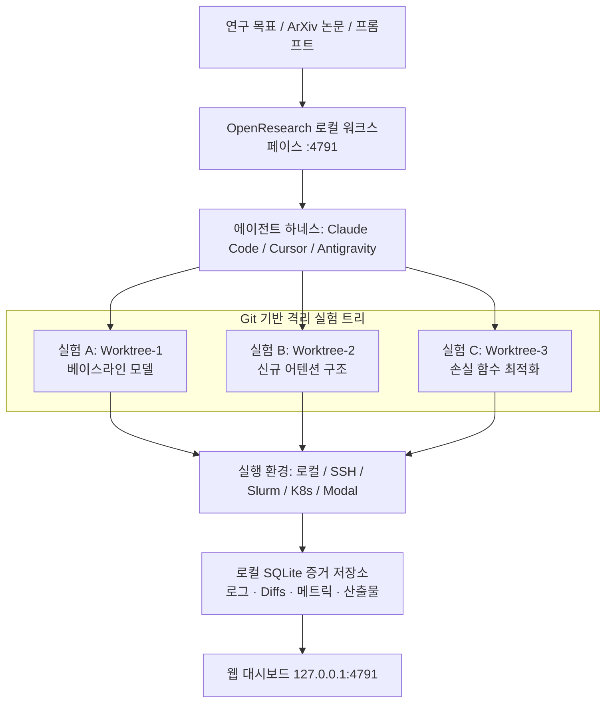

# OpenResearch: 코딩 에이전트를 자율 연구 에이전트로 확장하는 로컬 우선(Local-First) 오토리서치 워크스페이스

## 1. 개요 및 패러다임

Claude Code, Cursor, Codex, Google Antigravity 등의 상용 코딩 에이전트들은 개별 파일 수정과 단위 테스트 작성에는 능숙하지만, 복수 연구 가설을 수립하고, 실험을 병렬 실행하며, 학술 논문과 결과를 증거 기반으로 비교·분석하는 **자율 과학 연구(Autoresearch)**를 수행하기에는 형상 관리 및 실험 계보(Lineage) 추적 인프라가 부족했다.

**OpenResearch (alphaXiv 개발)**는 로컬 머신에서 구동되는 오픈소스 오토리서치 워크스페이스로, 개발자가 보유한 코딩 에이전트에 자율 연구 스킬을 주입하여 **문헌 검토(Literature Review) $\to$ 가설 수립 $\to$ 실험 실행 $\to$ 증거 기반 리포트 생성**의 전 주기를 자율화한다.



---

## 2. 6대 핵심 설계 원칙

| 설계 원칙 | 설명 및 구현 메커니즘 |
| :--- | :--- |
| **병렬 탐색 (Parallel Exploration)** | 독립된 Git 워크트리(Worktree)를 할당하여 브랜치 간 충돌 없이 복수 연구 방향을 동시 탐색. |
| **재현 가능한 실험 (Reproducible Experiments)** | 실행된 모든 실험은 Git 커밋 해시와 불변(Immutable) 아카이브로 묶여 100% 동일 재현 보장. |
| **문맥화된 증거 (Evidence in Context)** | 실행 로그, 코드 변경 diff, GPU 지표, 텐서보드 플롯을 해당 커밋에 영구 결합하여 저장. |
| **에이전트 선택의 자유 (Agent Agnostic)** | 세션별로 Claude Code, Cursor, OpenCode, Google Antigravity 등 최적의 에이전트 런타임 교체. |
| **컴퓨팅 인프라 추상화 (Run Anywhere)** | 동일 코드를 수정 없이 로컬 머신, SSH 리모트 GPU, Slurm HPC 클러스터, Ray, Modal에서 즉시 실행. |
| **로컬 소유권 (Local Ownership)** | 모든 대화, 코드, 실험 결과가 `127.0.0.1:4791`의 로컬 SQLite DB에 저장되어 외부 유출 차단. |

---

## 3. 자율 연구 루프 (Autoresearch Loop)

OpenResearch 에이전트는 인간 연구자의 개입 없이 다음과 같은 연속 루프를 순환한다:

1. **가설 수립 (Propose)**: 기존 실험 결과 또는 `orx paper <arxiv-id>`를 통해 다운로드한 최신 논문을 분석하여 다음 시도할 아이디어 도출.
2. **코드 변경 (Mutate)**: 격리된 워크트리에서 모델 구조나 하이퍼파라미터 코드를 수정.
3. **실험 실행 (Launch)**: `orx exp run`으로 지정된 컴퓨팅 리소스에 학습 잡을 제출.
4. **증거 평가 (Inspect)**: 검증 손실(Validation Loss) 및 벤치마크 점수를 파싱하여 개선 여부 확인.
5. **결정 및 전진 (Decide)**: 성과가 입증된 브랜치를 메인 실험 트리에 병합하고 후속 가설을 수립.

---

## 4. CLI 도구 (`orx`) 및 설치 가이드

### 4.1. 설치 및 서비스 기동

```bash
# macOS / Linux 원라인 설치
curl -LsSf https://openresearch.sh/install.sh | sh

# 로컬 대시보드 기동 (기본 포트 4791)
orx up
```

원격 GPU 서버에서 구동하면서 로컬 브라우저로 접속할 경우:
```bash
orx up --remote user@gpu-cluster.internal
```

### 4.2. 주요 CLI 명령어 모음

```bash
# 지원 코딩 에이전트에 OpenResearch 스킬 주입
orx install-skills

# 프로젝트 및 실험 관리
orx projects
orx project view <project-id>
orx runs <project-id>
orx logs <run-id>
orx exp run <experiment-id>

# 논문 및 키워드 탐색
orx discover keyword "Test-Time Compute scaling"
orx paper 2609.30063
```

---

## 5. 기존 위키 에이전트 시스템과의 융합

1. **[[wiki/Agents/Evaluations/TasteVal-Scientific-Research-Taste-Benchmark.md]] (TasteVal 연동)**:
   - TasteVal의 '연구자-코더 분리' 프로토콜을 `orx`의 다중 워크트리 상에 매핑하여, 에이전트의 실험 설계 직관(Research Taste)을 실시간 채점.
2. **[[wiki/Agents/Self-Evolving/WikiSkill-절차적-지식-자가-진화-프레임워크.md]]**:
   - 실험 실행 중 성공한 파이프라인과 실패한 트러블슈팅 로그를 WikiSkill 3계층(로그-위키-스킬)으로 승격하여 에이전트의 절차적 지식 영구 축적.

---

## 🔗 관련 문서 링크
- [[wiki/Agents/Evaluations/TasteVal-Scientific-Research-Taste-Benchmark.md]] — AI 연구 직관 및 과학적 탐구력 측정 벤치마크
- [[wiki/Agents/Self-Evolving/SkillOpt-및-과학적-탐구-멀티-에이전트-시스템.md]] — 과학적 탐구 멀티 에이전트 시스템
- [[wiki/Engineering/AI-Native-Engineering/Agentic-Software-Factory.md]] — 에이전트 네이티브 소프트웨어 팩토리
- [[wiki/Agents/Frameworks/000_Frameworks-MOC.md]] — 에이전트 프레임워크 색인
