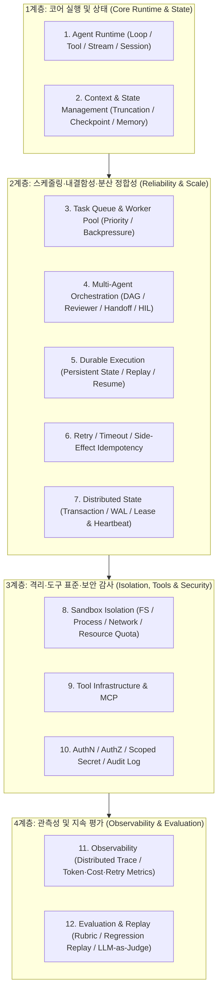

# 프로덕션 에이전트 인프라(Agent Infra) 12대 핵심 문제와 표준 아키텍처 패턴

## 1. 핵심 요약 (Executive Summary)
에이전트(Agent)는 모델을 1회 호출하고 종료되는 무상태(Stateless) 함수가 아니라, 수 분에서 수 시간 동안 **도구 호출 → 결과 확인 → 다음 행동 결정**을 반복하며 그 사이에 모델 오류, 네트워크 단절, 프로세스 재시작을 겪는 **장기 실행 분산 시스템(Long-Running Distributed System)**이다.

본 문서는 에이전트가 실무 환경에서 작업을 끝까지 안전하고 일관되게 완수하도록 뒷받침하는 **에이전트 인프라(Agent Infra)의 12대 핵심 엔지니어링 문제와 표준 해법**을 아키텍처 레퍼런스로 정의한다.

---

## 2. 에이전트 인프라 4계층 아키텍처 및 12대 패턴 매핑

---

## 3. 12대 핵심 문제 및 엔지니어링 구현 명세

| # | 핵심 문제 (Problem) | 아키텍처 해법 (Solution) | 필수 구현 메커니즘 및 실무 설계 포인트 |
| :--- | :--- | :--- | :--- |
| **1** | 단일 모델 API 호출만으로는 작업을 이어가지 못함 | **Agent Runtime** | - **Agent Loop**: 모델 호출 → 도구 실행 → 결과 반영 반복 - **Tool Calling**(외부 기능), **Streaming**(중간 상태 피드백), **Session**(작업 흐름 유지) |
| **2** | 긴 작업에서 컨텍스트 오염 및 진행 위치 상실 | **Context / State Management** | - **Truncation & Compression**으로 핵심 정보만 활성 컨텍스트에 유지 - **State & Checkpoint**로 진행 단계 기록, 단기 Context와 장기 Memory([[wiki/Agents/Memory-and-Cognition/TencentDB-Agent-Memory-Semantic-Pyramid.md|시맨틱 피라미드]] 등) 분리 |
| **3** | 작업 폭주 시 처리 순서 및 자원 통제 불가 | **Task Queue / Worker Pool** | - 작업을 Queue에 적재하고 Worker Pool이 소비 - 동시 실행 수, 우선순위 제어 및 **Backpressure**로 유입 속도를 조절해 연쇄 과부하 차단 |
| **4** | 단일 에이전트의 복합 작업 실패 및 검증 난항 | **Multi-Agent Orchestration** | - 하위 작업을 분할해 의존성을 **DAG**로 표현 - **Reviewer** 검토 및 **Handoff** 작업 인계, 고위험 결정만 선택적 **Human-in-the-Loop (HIL)** 적용 |
| **5** | 수 시간 걸린 작업이 프로세스 재시작 1회로 증발 | **Durable Execution** | - 실행 상태를 영구 저장소에 기록하고 매 스텝 **Checkpoint** 생성 - 장애 복구 시 **Replay & Resume**으로 중단 지점부터 정확히 재개 |
| **6** | 무분별한 재시도로 외부 부수 효과 중복 발생 | **Retry / Timeout / Idempotency** | - 재시도 가능 오류(Transient)와 즉시 중단할 Timeout 구분 - **`git push`, 이메일 발송, 리소스 생성, 결제는 멱등성 키(Idempotency Key)로 단 1회 실행 보장** |
| **7** | 다중 오케스트레이터·워커 간 작업 상태 불일치 | **Distributed State / Consistency** | - **Transaction & WAL(Write-Ahead Log)**로 상태 변경 기록 - **Lease & Heartbeat**로 담당 워커 생존 확인 및 **Replication** 기반 장애 복구 |
| **8** | 코딩 에이전트의 Shell·Git·빌드가 호스트 오염 | **Sandbox Isolation** | - 에이전트별 파일시스템, 프로세스, 네트워크 네임스페이스 격리(MicroVM/Firecracker/gVisor) - CPU, 메모리, 최대 실행 시간(Wall-clock Quota) 하드 캡 적용 |
| **9** | 도구가 늘어날수록 연동 어댑터 파편화 | **Tool Infrastructure / MCP** | - Shell, Filesystem, Browser, DB, 외부 API를 일관된 규격으로 관리 - **MCP(Model Context Protocol)** 표준 인터페이스로 도구 탐색·호출 통일 |
| **10** | 과도한 권한으로 파일·네트워크·시크릿 유출 | **AuthN / AuthZ / Secret / Audit** | - **ACL**로 접근 가능 파일·도구·네트워크 도메인 제한([[wiki/Engineering/Security/Heimel-Consequence-Time-Authorization-Infrastructure.md|Heimel 결과 시점 인가]] 참조) - 시크릿은 별도 Vault에서 최소 범위만 주입하고 모든 행위를 **Audit Log**에 기록 |
| **11** | 어디서 왜 실패했는지 파악 불가하여 개선 불가 | **Observability** | - **Distributed Trace**로 에이전트 태스크의 전 실행 스텝 기록 - 지연 시간, 큐 대기열, 토큰 소모량, 비용, 실패율, 재시도 횟수 **Metrics** 수집 |
| **12** | 에러 없이 종료되었으나 실제 결과물은 오답 | **Evaluation / Replay** | - **Dataset & Rubric**으로 Task Success Rate 정량 측정 - **Regression Test & Replay**로 과거 성공 태스크 재검증 및 **LLM-as-Judge / Jev-as-a-Judge** 결합 |

---

## 4. 실무 병목 해결 팁: Multi-Agent Orchestration에서 인간(HIL)이 병목이 될 때
- 다중 에이전트 파이프라인에서 모든 중간 핸드오프마다 사람이 승인(HIL)하도록 설계하면 인간 검토자가 전체 처리량의 병목이 된다.
- **해결 패턴**:
  1. **결과 시점 위험 기반 게이팅([[wiki/Engineering/AI-Native-Engineering/Epistemic-Debt-ChangeScore-Friction-Gate.md|Epistemic Debt Friction Gate]])**: 읽기 전용 탐색이나 샌드박스 내 테스트는 완전 자율로 통과시키고, 외부 상태 변경(PR 머지, 프로덕션 배포, 스키마 변경)이나 저신뢰 결정([[wiki/Models/Optimization-and-Serving/AnyJev-and-Jeva-Decision-Model-Ecosystem.md|AnyJev/Jev]] 신뢰도 `< 0.8`)만 인간에게 에스컬레이션한다.
  2. **독립 검증 에이전트 선행 배치([[wiki/Agents/Coding-and-Engineering/Pstack-Tstack-and-Cumulative-Diff-Verification-Workflows.md|Pstack / Pullboard]])**: 사람에게 올리기 전에 두 번째 검증 전용 에이전트와 실제 앱 실행 체크리스트를 먼저 통과시켜 인간의 리뷰 부담을 최소화한다.

---

## 5. 관련 문서 (Cross-References)
- [[wiki/Agents/Implementation/Deep-Agents-Architecture-Patterns.md]]
- [[wiki/Engineering/AI-Native-Engineering/Agentic-Software-Factory.md]]
- [[wiki/Engineering/Security/Heimel-Consequence-Time-Authorization-Infrastructure.md]]
- [[wiki/Agents/Coding-and-Engineering/하네스-핸드북-및-하네스-이펙트-연구-2026.md]]
- [[wiki/Agents/Implementation/000_Implementation-MOC.md]]
