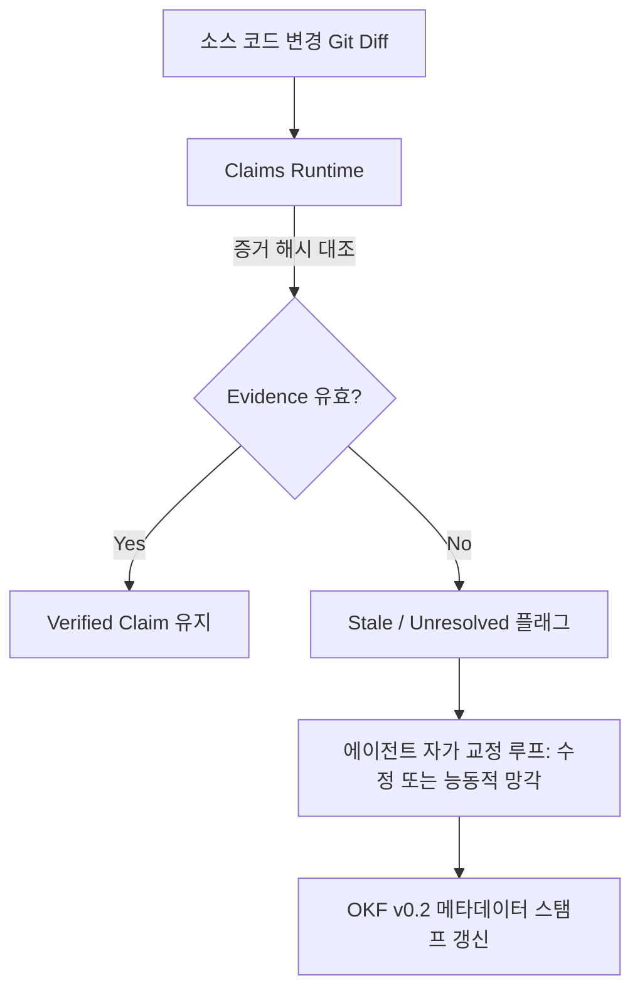

# OpenWiki Claims Runtime: 에이전트 자가 교정 메모리 및 증분 지식 거버넌스

에이전트가 소프트웨어 프로젝트를 유지보수할 때 발생하는 가장 큰 병목은 코드 변경에 따라 이전 메모리와 문서가 "낡은 거짓 지식(Stale Knowledge)"으로 변질되어 환각(Hallucination)을 유발하는 문제입니다. **OpenWiki v0.4.0**의 **Claims 런타임**은 위키를 단순 텍스트가 아닌 '증거 기반의 지속적 사실 원장'으로 다룸으로써 에이전트 메모리의 능동적 망각(Proactive Forgetting)과 자가 교정(Self-Correction)을 구현합니다.



---

## 1. 2계층 거버넌스: Claims vs OKF

OpenWiki 0.4.0은 검증 책임을 두 계층으로 완전히 분리합니다:

| 계층 | 역할 | 담당 메트릭 / 질문 |
| :--- | :--- | :--- |
| **Claims Runtime** | **내용 수준의 진실 (Content-level Truth)** | "이 문장이 주장하는 사실이 실제 코드의 어떤 라인에서 비롯되었는가?", "코드 변경 후에도 여전히 참인가?" |
| **OKF v0.2 Standard** | **페이지 수준의 신뢰 (Page-level Trust)** | "어떤 원천(Sources)에서 페이지가 빌드되었는가?", "전체 페이지가 인증(Verified)되었는가?", "어떤 에이전트(Actor)가 언제 생성했는가?" |

---

## 2. 핵심 메커니즘

### 2.1. 증거 기반 링킹 (Evidence-Based Linking)
- 각 마크다운 단락에 명시된 기술적 사실은 내부적으로 `claim_id`와 해당 소스 코드의 `(filepath, git_sha, line_range)` 튜플로 매핑됩니다.
- 단순한 벡터 유사도 검색과 달리, 결정론적(Deterministic) 증거 트리를 추적합니다.

### 2.2. 스테일 지식 자동 감지 및 능동적 망각
- Git 커밋이나 파일 수정 발생 시, OpenWiki 런타임은 변경된 파일 범위에 바인딩된 Claim만을 즉시 찾아내어 `status: stale`로 마킹합니다.
- 전체 위키를 처음부터 다시 컴파일할 필요 없이, 오염된 Claim만을 타깃팅하여 재평가하거나 완전히 삭제(Proactive Forgetting)합니다.

### 2.3. 에이전트 액터 스탬프 (Actor Stamping)
- OKF v0.2 프런트매터에 페이지 작성 주체를 명시적으로 기록합니다.
  - `actor: "native-openwiki"`
  - `actor: "claude-code-agent"`
  - `actor: "cursor-agent"`
- 다중 에이전트가 협업하는 환경에서 어떤 에이전트가 언제 해당 지식을 갱신했는지 추적 가능하여 감사(Auditability)를 보장합니다.

---

## 3. CLI 및 실무 파이프라인 연동

```bash
# 1. 특정 커밋 변경 사항에 바인딩된 Claims 무결성 검증
openwiki claims check --since=HEAD~1

# 2. Stale로 플래그된 Claim 자동 교정 프롬프트 실행
openwiki claims repair --agent=claude-code --model=sonnet

# 3. OKF v0.2 표준 메타데이터 감사
openwiki lint --standard=okf-0.2
```

---

## 4. 증거 그래프(Evidence Graph) 결합을 통한 교차 문서 추론 및 인용 일관성 극대화

금융·보험 약관처럼 문서 간 상호 참조·개정(`amends`)·대체(`supersedes`)가 빈번한 엔터프라이즈 환경에서, LangChain 연구진은 **111개 장문 보험 문서와 972개 사실 원장(Fact Ledger)** 벤치마크(단순 조회 80문항 + 다중 문서 연결 추론 50문항, 문항당 3회 반복 측정)를 통해 **Search 단독 vs 컴파일된 OpenWiki vs OpenWiki + Evidence Graph**의 성능을 실측했다.

### 4.1 컴파일된 위키(Compiled Wiki)의 효과와 인용 불안정성 한계
- **컴파일 비용**: 111개 문서를 원본의 약 1/10 크기 위키로 컴파일하는 데 `USD 4.15`가 소요되었으며, 이후 문서 17개 증분 추가 시 문서당 약 `USD 0.09`가 소요되었다.
- **단순 조회(Simple Lookups, 80문항)**: 단일 단락으로 답할 수 있는 질문에서는 Search 단독과 Wiki가 거의 동일한 정확도(`0.84` vs `0.83`)와 인용 일치도(`0.72` vs `0.74`, 정답당 비용 `USD 0.020` vs `USD 0.021`)를 보였다.
- **교차 문서 연결 질의(Connected Questions, 50문항)**: 여러 문서의 의존성을 추적해야 하는 질문에서 **OpenWiki는 Search 단독 대비 정확도를 약 5배(`0.10` → `0.52`) 향상**시키고 정답당 비용을 `USD 0.55`에서 `USD 0.19`로 절감했다.
- **인용 일관성(Citation Overlap) 하락 문제**: 그러나 연결 질의에서 3회 실행 간 동일 근거를 인용하는 일관성(Jaccard 유사도)은 단순 조회(`0.74`) 대비 **`0.25`로 급락**했다. 마크다운 텍스트 인용만으로는 에이전트가 매번 다른 경로로 증거를 재탐색하기 때문이다.

### 4.2 결정론적 증거 그래프(Evidence Graph)와 `locate` / `expand` 도구
추가 LLM 호출 없이(1초 미만 빌드) 위키의 기존 인용과 문서 참조를 **타입화된 명시적 엣지(Typed Edges)**로 구체화(Materialize)하여 에이전트에게 안정적인 증거 탐색 경로를 제공한다.
1. **문단(Paragraph) 원자화**: 각 문서를 결정론적으로 문단 단위로 분할하고 고유 ID를 부여하여 문서 전체가 아닌 정확한 지지 문단에 Claim을 연결한다.
2. **타입화된 엣지(`cites`, `refers_to`, `supersedes`, `amends`, `attaches_to`)**: 위키 Claim이 이미 텍스트 인용을 보유하므로 추가 모델 호출 없이 그래프 엣지를 생성한다.
3. **2개 전용 탐색 도구**:
   - `locate(terms, within)`: 질문 키워드를 문서 제목, 섹션 헤더, 위키 페이지, Claim 진술문과 매칭해 탐색 시작 노드를 찾는다.
   - `expand(node, edges, hops)`: 노드의 타입화된 엣지를 따라가며, 단일 경로일 때는 자동으로 전진하고 분기점(Branch)에서만 에이전트가 선택하도록 제어한다.

```python
@tool(parse_docstring=True)
async def locate(terms: str, within: str | None = None) -> dict:
    """Find where to start: match the question's words against document titles,
    section headings, wiki pages, and claim statements."""
    ...

@tool(parse_docstring=True)
async def expand(node: str, edges: list[str] | None = None, hops: int = 1) -> dict:
    """Open one node and list its typed edges (cites, refers_to, supersedes,
    amends, attaches_to, and their inverses). With hops > 1 and one edge type,
    walk that edge while there is a single path, and stop at a branch."""
    ...
```

### 4.3 Evidence Graph 결합 후 정량 성과 (vs Wiki 단독)
| 평가 지표 (Connected Questions) | Search 단독 | OpenWiki 단독 | **OpenWiki + Evidence Graph** | 개선 효과 (vs Wiki 단독) |
| :--- | :--- | :--- | :--- | :--- |
| **정확도 (Accuracy)** | 0.10 | 0.52 | **+27% 추가 상승 (약 0.66)** | Search 대비 **6.5배 이상** 정확 |
| **인용 일관성 (Citation Overlap)** | - | 0.25 | **2배 향상 (2x Consistency)** | 재현 및 감사 가능한 근거 추적 보장 |
| **중앙값 응답 시간 (Median Latency)** | - | 기준치 | **-40% 단축** | 불필요한 재검색 루프 제거 |
| **정답당 비용 (Cost per Correct Answer)** | `USD 0.55` | `USD 0.19` | **-58% 추가 절감 (`~USD 0.08`)** | 다중 에이전트 반복 질의 시 컴파일 비용 상쇄 |

---

## 🔗 관련 문서
- [[wiki/RAG/OpenWiki-OKF-Codebase-Documentation.md|OpenWiki OKF 코드베이스 문서화]]
- [[wiki/Agents/Implementation/OpenWiki-Graph-Visualization.md|OpenWiki 그래프 시각화]]
- [[wiki/Agents/Memory-and-Cognition/TencentDB-Agent-Memory-Semantic-Pyramid.md|TencentDB Agent Memory 시맨틱 피라미드]]
- [[wiki/Agents/Memory-and-Cognition/RAW-RAG-Raw-History-Retrieval-Baseline.md|RAW-RAG 원본 기록 리랭킹 베이스라인]]
- [[wiki/Agents/Memory-and-Cognition/000_Memory-and-Cognition-MOC.md|Memory-and-Cognition MOC]]
- [[wiki/Agents/Memory-and-Cognition/AI-Agent-Memory-Architecture.md|AI Agent Memory Architecture]]
- [[wiki/Agents/Memory-and-Cognition/Mem0-vs-Cognee-Comparison-2026.md|Mem0 vs Cognee 비교 2026]]
