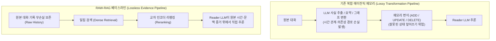

# RAW-RAG: 에이전트 메모리 시스템의 손실 변형 한계와 원본 대화 기록 리랭킹 베이스라인

## 1. 핵심 요약 (Executive Summary)
**RAW-RAG**(*Is Complex Agentic Memory Always Needed? Naive RAG Is Stronger Than We Thought*)는 수집 시점의 LLM 요약, 지식 그래프 구축, 사실 추출 및 메모리 변이(`UPDATE`/`DELETE`)를 일절 수행하지 않고 **원본 대화 기록(Raw History)을 그대로 보존한 뒤 `Dense Retrieval → Reranking → Reader LLM`만 수행하는 단순 베이스라인**이 `LoCoMo`, `LongMemEval`, `MEME`, `MemoryAgentBench` 4대 벤치마크의 **7개 설정 중 6개에서 복잡한 에이전틱 메모리 시스템들을 제치고 1위를 차지**(일부 설정에서 +5점 이상 우위)함을 입증한 연구다.

---

## 2. 아키텍처 비교: 복잡한 에이전틱 메모리 vs `RAW-RAG`

---

## 3. 왜 복잡한 메모리 파이프라인이 원본 기록에 패배하는가?

### 3.1 손실 변환의 덫 (Every Transformation Loses Relational Context)
- 기존 에이전틱 메모리 시스템([[wiki/Agents/Memory-and-Cognition/Mem0-vs-Cognee-Comparison-2026.md|Mem0, Cognee 등]])은 수집 단계에서 대화를 정제된 원자적 사실(Atomic Facts), 요약문, 또는 그래프 노드로 변환한다.
- 그러나 **정답 값(Answer Value) 하나만 인출하는 것으로는 충분하지 않은 경우가 많다**. 현재 무엇이 진실인지 판단하려면 그 정보 주변의 **시간적 선후 관계(Temporal Relationships), 선행 이벤트, 조건부 의존성 경로(Dependency Paths)**가 함께 필요한데, 수집 시점의 요약·추출 과정에서 이러한 맥락 고리가 소실된다.
- 실제로 연구진이 모델에게 **변환된 메모리 저장소 전체에 대한 완전한 접근 권한**을 부여했음에도, 원본 대화 증거(`Raw History`)를 직접 읽는 것보다 성능이 낮았다.

### 3.2 메모리 변이(`UPDATE` / `DELETE`)의 역설
- 많은 에이전트 메모리 프레임워크가 최신 상태를 유지한다며 기존 기억을 수정(`UPDATE`)하거나 삭제(`DELETE`)하는 메모리 변이(Memory Mutation)를 수행한다.
- 그러나 실험에서 **Mem0의 `UPDATE`와 `DELETE` 기능을 비활성화(Disable)하자 오히려 정확도가 상승**했다.
- 이는 수집 시점의 경량 추출기가 불완전한 문맥으로 상태를 잘못 덮어쓰거나 삭제하여 영구적인 정보 손실을 일으키기 때문이며, 강력한 최신 Reader LLM은 원본 이력에 과거와 현재 발화가 함께 남아 있을 때 스스로 시간 순서를 대조하여 현재 상태를 더 정확히 추론해낸다.

---

## 4. 엔지니어링 설계 원칙 및 아키텍처 가이드라인
1. **복잡한 메모리 도입 전 `RAW-RAG`를 필수 베이스라인으로 설정하라**:
   - 고비용 LLM 수집 파이프라인이나 그래프 DB를 도입하기 전에, `원본 대화 청크 + Dense Retrieval + 전용 Reranker`([[wiki/Models/Optimization-and-Serving/AnyJev-and-Jeva-Decision-Model-Ecosystem.md|Cross-Encoder Reranker]]) 조합을 먼저 측정하고 이를 상회하는지 검증해야 한다.
2. **규제·감사 도메인에서의 불변 원장(Immutable Raw Log) 보존**:
   - 금융·보험·의료 등 감사 추적성(Auditability)이 요구되는 환경에서는 요약된 메모리를 진실의 원천(Source of Truth)으로 삼지 말고, [[wiki/Agents/Memory-and-Cognition/TencentDB-Agent-Memory-Semantic-Pyramid.md|TencentDB Agent Memory]]의 `L0` 계층이나 [[wiki/Agents/Memory-and-Cognition/OpenWiki-Claims-Runtime-Self-Correcting-Memory.md|OpenWiki]]의 라인 해시 클레임처럼 **항상 원본 대화/문서로 역추적 가능한 무손실 구조**를 유지해야 한다.

---

## 5. 관련 문서 (Cross-References)
- [[wiki/Agents/Memory-and-Cognition/Mem0-vs-Cognee-Comparison-2026.md]]
- [[wiki/Agents/Memory-and-Cognition/TencentDB-Agent-Memory-Semantic-Pyramid.md]]
- [[wiki/Agents/Memory-and-Cognition/OpenWiki-Claims-Runtime-Self-Correcting-Memory.md]]
- [[wiki/RAG/Graphiti-Architecture.md]]
- [[wiki/Models/Optimization-and-Serving/AnyJev-and-Jeva-Decision-Model-Ecosystem.md]]
- [[wiki/Agents/Memory-and-Cognition/000_Memory-and-Cognition-MOC.md]]
