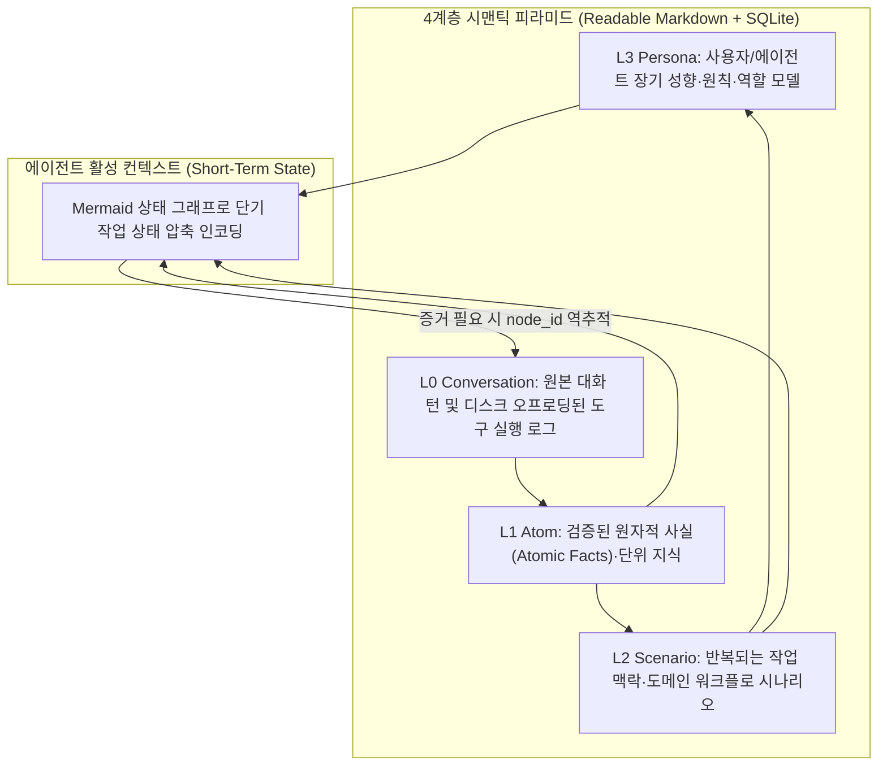

# TencentDB Agent Memory: SQLite 기반 4계층 시맨틱 피라미드 및 무손실 로컬 에이전트 메모리

## 1. 핵심 요약 (Executive Summary)
**TencentDB Agent Memory**는 텐센트 클라우드(Tencent Cloud)가 오픈소스로 공개한 **100% 로컬 실행형 에이전트 장기 메모리 프레임워크**다. 외부 벡터 데이터베이스(Pinecone 등)나 클라우드 API 의존성 없이 단일 **SQLite**와 사람이 읽을 수 있는 마크다운(Markdown) 계층 구조만으로 동작하며, 불투명한 벡터 압축 대신 **4계층 시맨틱 피라미드(`L0 Conversation → L1 Atom → L2 Scenario → L3 Persona`)**와 **Mermaid 그래프 기반 단기 상태 인코딩**을 통해 **토큰 소모량을 61% 절감**하고 **PersonaMem 정확도를 48%에서 76%로 향상**시켰다.

---

## 2. 아키텍처 설계: 왜 불투명한 벡터 더미(Opaque Vector Pile)를 버렸는가?
기존 벡터 DB 기반 에이전트 메모리는 대화 기록을 임베딩 청크나 손실 요약(Lossy Summary)으로 압축해 저장하므로, 리콜(Recall) 실패 시 왜 잘못된 기억이 인출되었는지 디버깅하거나 원본 증거를 역추적하기 어렵다([[wiki/Agents/Memory-and-Cognition/RAW-RAG-Raw-History-Retrieval-Baseline.md|RAW-RAG]] 참조). TencentDB Agent Memory는 **무손실 계층적 구조화(Lossless Hierarchical Structuring)**와 **심볼릭 상태 오프로딩**으로 이를 해결한다.

### 2.1 4계층 시맨틱 피라미드 (L0 → L3)
모든 계층은 에이전트와 개발자가 직접 열어 읽고 감사(Audit)할 수 있는 마크다운 문서와 로컬 SQLite 인덱스로 유지된다.
1. **`L0 Conversation` (원본 대화 및 디스크 로그)**: 원본 대화 원문과 장황한 도구 호출 출력(Verbose Tool Logs)을 손실 없이 디스크에 보존한다.
2. **`L1 Atom` (원자적 사실 계층)**: 대화에서 추출된 개별 엔티티, 설정값, 의사결정 등 최소 단위의 사실을 `node_id`와 함께 기록한다.
3. **`L2 Scenario` (시나리오/에피소드 계층)**: 연관된 `L1 Atom`들을 묶어 프로젝트별·작업 유형별 시나리오 문맥을 형성한다.
4. **`L3 Persona` (페르소나/거버넌스 계층)**: 세션 전반에 걸쳐 유지되어야 하는 사용자 선호도, 코딩 규칙, 아키텍처 제약사항을 최상위 추상 계층으로 유지한다.

### 2.2 Mermaid 단기 상태 그래프 & `node_id` 무손실 드릴다운
- **단기 상태의 Mermaid 인코딩**: 진행 중인 작업의 단기 상태(Short-term state)를 장황한 자연어 히스토리 대신 **컴팩트한 Mermaid 다이어그램 그래프** 형태로 에이전트 컨텍스트에 주입하여 문맥 토큰을 **61% 절감**한다.
- **도구 로그 디스크 오프로딩 및 `node_id` 역추적**: 수천 줄에 달하는 도구 실행 결과(터미널 출력, JSON 응답 등)는 컨텍스트에서 즉시 디스크로 오프로딩하고 그래프에는 `node_id` 포인터만 남긴다. 에이전트가 추론 도중 정확한 원본 증거(Proof)가 필요할 때만 `node_id`를 통해 `L0` 원본 로그로 무손실 드릴다운(Drill-down)한다.

---

## 3. 정량적 성능 지표 및 비교

| 평가 항목 | 기존 벡터 압축 메모리 | TencentDB Agent Memory | 비고 |
| :--- | :--- | :--- | :--- |
| **컨텍스트 토큰 소비량** | 기준치 (100%) | **-61% 절감 (39%)** | Mermaid 그래프 단기 상태 인코딩 + 로그 오프로딩 |
| **PersonaMem 정확도** | 48.0% | **76.0% (+28.0%p)** | L0~L3 시맨틱 피라미드 계층 인출 |
| **외부 인프라 의존성** | 클라우드 Vector DB / API 필요 | **Zero (순수 로컬 SQLite + Markdown)** | 오프라인·에어갭 환경 즉시 구동 |
| **정보 손실 및 감사 가능성** | 손실 요약 / 블랙박스 임베딩 | **무손실 (`node_id` 원문 역추적)** | 모든 계층 마크다운 직접 열람 가능 |

---

## 4. 관련 문서 (Cross-References)
- [[wiki/Agents/Memory-and-Cognition/Hierarchical-Memory-for-LLMs-계층적-메모리-구조.md]]
- [[wiki/Agents/Memory-and-Cognition/RAW-RAG-Raw-History-Retrieval-Baseline.md]]
- [[wiki/Agents/Memory-and-Cognition/OpenWiki-Claims-Runtime-Self-Correcting-Memory.md]]
- [[wiki/Agents/Implementation/Supermemory-Architecture-and-MCP.md]]
- [[wiki/Agents/Memory-and-Cognition/Mem0-vs-Cognee-vs-QMD-Comparison.md]]
- [[wiki/Agents/Memory-and-Cognition/000_Memory-and-Cognition-MOC.md]]
