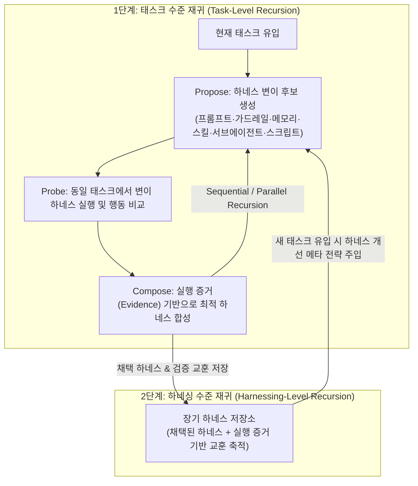

# Harness² (Harness Squared) 및 메타하네스: 가중치 고정 이중 재귀 에이전트 하네스 자가 진화 프레임워크

## 1. 핵심 요약 (Executive Summary)
기반 LLM의 가중치(Weights)를 전혀 수정하지 않고 에이전트를 둘러싼 **하네스(Harness: 시스템 프롬프트, 가드레일, 메모리, 도구 가이드, 서브에이전트, 스킬, 스크립트, 플러그인)** 자체를 실행 증거(Execution Evidence)로부터 재귀적으로 진화시키는 아키텍처가 에이전트 엔지니어링의 핵심 표준으로 부상했다.
- **Google Research `Harness²` (Harness Squared)**: 현재 태스크를 위한 하네스를 `Propose → Probe → Compose` 루프로 개선하는 **태스크 수준 재귀(Task-level Recursion)**와, 태스크 간 축적된 채택 하네스 및 실행 교훈을 바탕으로 향후 새 태스크에서 하네스를 설계하는 능력 자체를 진화시키는 **하네싱 수준 재귀(Harnessing-level Recursion)**의 **이중 재귀(Two-Level Recursion)** 아키텍처를 오픈소스로 공개했다.
- **클로드 코드 메타하네스 V2 & `codex-harness`**: 호스트 환경을 오염시키지 않는 순정(Vanilla) 상태에서 에이전트 팀 하네스를 즉시 구성하며, Claude Code의 **Dynamic Workflow** 기능 및 OpenAI Codex용 `codex-harness`와 결합해 멀티 에이전트 팀 오케스트레이션을 자동화한다.

---

## 2. Google `Harness²`: 이중 재귀(Two-Level Recursion) 아키텍처

### 2.1 편집 가능한 하네스 구성요소 (Editable Harness Space)
`Harness²`에서 에이전트가 자율적으로 수정·조합하는 하네스 범위는 단순 시스템 프롬프트에 그치지 않고 다음 8대 실행 레이어 전체를 포괄한다.
1. **System Prompt** (역할 및 추론 지침)
2. **Guardrails** (입출력 및 실행 안전 제약)
3. **Memory** (컨텍스트 유지 및 인출 구조)
4. **Tool Guidance** (도구 선택 및 파라미터 사용 규칙)
5. **Subagents** (하위 위임 에이전트 정의 및 역할 분담)
6. **Skills** (절차적 작업 수행 플레이북)
7. **Scripts** (반복 연산·검증용 실행 코드)
8. **Plugins** (외부 환경 연동 어댑터)

### 2.2 태스크 수준 재귀 vs 하네싱 수준 재귀
| 재귀 계층 | 루프 메커니즘 | 최적화 대상 | 지속성 범위 |
| :--- | :--- | :--- | :--- |
| **태스크 수준 재귀 (Task-Level Recursion)** | **`Propose → Probe → Compose`** - **Parallel 모드**: 여러 후보 하네스를 병렬 탐색 - **Sequential 모드**: 정제된 하네스와 누적 증거를 다단계로 연속 개선 | 눈앞의 현재 태스크(Current Task)에 최적화된 실행 하네스 | 단일 태스크 내 |
| **하네싱 수준 재귀 (Harnessing-Level Recursion)** | 태스크 완료 후 채택된 하네스와 실행 증거로 뒷받침된 교훈(Evidence-backed lessons)을 영구 보존 | **미래의 새로운 태스크에서 더 나은 하네스를 구축하는 메타 능력 자체** | 다중 태스크 간 영구 누적 |

### 2.3 벤치마크 검증 결과
- Google Research 실험 결과, **단 1회의 `Harness²` 스텝만으로도 `GLM-5`와 `Gemini 3.5 Flash`의 성능이 `JobBench`, `LAB`, `WorkBuddy-Bench` 전 구간에서 유의미하게 향상**되었으며, 태스크 수준 재귀 예산을 늘릴수록 추가 성능 향상이 확인되었다.

---

## 3. 메타하네스(Meta-Harness) V2 및 `codex-harness` 실무 패턴
- **순정 상태(Zero-Pollution) 멀티 에이전트 하네스 구성**: 기존 프로젝트 설정이나 글로벌 환경을 어지럽히지 않고 `"하네스 구성해줘"` 한 줄 명령으로 프로젝트 맞춤형 에이전트 팀 하네스를 즉석 생성한다(GitHub 9.1k+ Stars).
- **Claude Code Dynamic Workflow 결합 (V2)**: 정적 서브에이전트 호출을 넘어 태스크 진행 상황에 따라 워크플로 그래프를 동적으로 분기·재구성하는 Claude Code Dynamic Workflow와 결합해 복합 엔지니어링 작업을 자율 수행한다.
- **크로스 런타임 이식성 (`codex-harness`)**: 동일한 메타하네스 설계 철학을 OpenAI Codex CLI 환경에서도 그대로 사용할 수 있도록 `codex-harness` 패키지로 제공한다.

---

## 4. 관련 문서 (Cross-References)
- [[wiki/Agents/Coding-and-Engineering/하네스-핸드북-및-하네스-이펙트-연구-2026.md]]
- [[wiki/Engineering/Infrastructure-and-DevOps/Meta-Agent-Harness-Policy-Learning.md]]
- [[wiki/Agents/Self-Evolving/WikiSkill-절차적-지식-자가-진화-프레임워크.md]]
- [[wiki/Agents/Self-Evolving/SkillOpt-및-과학적-탐구-멀티-에이전트-시스템.md]]
- [[wiki/Agents/Coding-and-Engineering/Pstack-Tstack-and-Cumulative-Diff-Verification-Workflows.md]]
- [[wiki/Agents/Self-Evolving/000_Self-Evolving-MOC.md]]
