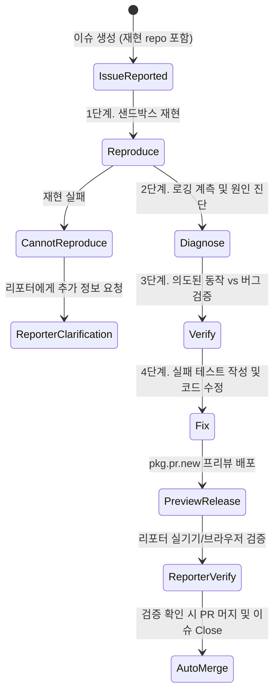

# Flue 프레임워크: Astro의 GitHub Actions 기반 자율 이슈 트리아지 및 소프트웨어 팩토리

## 1. 배경: 오픈소스 메인테이너 번아웃과 소프트웨어 팩토리

AI 코딩 어시스턴트의 보급으로 누구나 클릭 한 번으로 버그 리포트와 풀 리퀘스트(PR)를 대량 생성할 수 있게 되었지만, 이를 검토하고 재현·수정해야 하는 인간 메인테이너의 시간은 고정되어 있어 오픈소스 생태계 전반이 병목과 번아웃에 직면하였다.

웹 프레임워크 **Astro** 팀은 방치된 티켓을 일괄 종료(Issue Bankruptcy)하거나 콜드 클로즈하지 않고, GitHub Actions 내부에서 격리된 AI 서브에이전트 팀을 구동하여 200개 이상의 미해결 이슈를 30개 미만(목표: 0건)으로 감축시킨 실전 프로덕션 시스템을 구축하였다. 이 엔진은 오픈소스 프레임워크인 **Flue (flueframework.com)** 및 **`withastro/triagebot-action@v1`**으로 표준화되었다.



---

## 2. 4단계 트리아지 파이프라인 (라벨 기반 상태 머신)

전체 파이프라인은 복잡한 중앙 오케스트레이터 대신, **GitHub 이슈 라벨(Labels)에 의해 구동되는 유한 상태 머신(Finite State Machine)**으로 동작한다:

1. **재현 (Reproduce)**:
   - 사용자가 제공한 최소 재현 저장소(StackBlitz/GitHub URL)를 격리된 일회용 샌드박스에 클론하여 실제로 버그가 발생하는지 검증.
2. **진단 (Diagnose)**:
   - Astro 코드베이스 내부의 핵심 컴포넌트에 동적 로깅 및 디버깅 계측 코드를 자동 삽입하여 버그가 발생하는 근본 원인(Root Cause)의 스택 트레이스를 추적.
3. **검증 (Verify)**:
   - 관련 테스트 스위트, 코드 주석, 아키텍처 가이드를 대조하여 해당 동작이 진정한 결함인지, 의도된 스펙(Intended Behavior)인지 판별. LLM 특유의 '존재하지 않는 버그를 억지로 해결하려는 편향'을 방지하기 위해 진단과 검증 에이전트의 모델을 분리.
4. **수정 (Fix)**:
   - 재현 케이스를 Astro 모노레포의 정규 실패 단위 테스트(Failing Unit Test)로 변환한 후, 최소 변경 원칙에 따라 코드를 수정하고 전체 회귀 테스트를 통과시킴.

---

## 3. `pkg.pr.new` 기반 프리뷰 릴리스 및 검증 루프

수정이 완료된 즉시 메인 브랜치에 머지하지 않고, 지속적 프리뷰 도구인 **`pkg.pr.new`**를 통해 임시 npm 패키지를 즉시 빌드·게시한다:

```markdown
<!-- 트리아지 봇의 자동 댓글 예시 -->
Astro TriageBot이 이 버그를 해결하는 패치를 생성했습니다!
다음 프리뷰 패키지를 설치하여 문제가 해결되었는지 직접 확인해 주세요:

```bash
npm install https://pkg.pr.new/astro@3821
```

문제가 해결되었다면 댓글로 확인을 남겨주시면 PR이 자동으로 승인됩니다.
```

이 방식을 통해 인간 메인테이너의 시간 소모 없이, 버그를 최초 제기한 당사자가 자신의 실제 애플리케이션 환경에서 패치 유효성을 검증(Human-in-the-Loop)하도록 유도한다.

---

## 4. GitHub Actions 워크플로우 설정 가이드

Astro 팀이 공개한 표준 배포 액션 매니페스트:

```yaml
name: Autonomous Issue Triage
on:
  issues:
    types: [opened, labeled]

jobs:
  triage:
    runs-on: ubuntu-latest
    steps:
      - name: Checkout Codebase
        uses: actions/checkout@v4

      - name: Run Flue TriageBot
        uses: withastro/triagebot-action@v1
        with:
          read-token: ${{ secrets.GITHUB_TOKEN }}
          write-token: ${{ secrets.BOT_GITHUB_TOKEN }}
          cloudflare-api-key: ${{ secrets.CLOUDFLARE_API_KEY }}
          cloudflare-account-id: ${{ secrets.CLOUDFLARE_ACCOUNT_ID }}
          # Cloudflare Workers AI 상의 고속 코드 모델 활용
          triage-model: cloudflare-workers-ai/@cf/moonshotai/kimi-k2.7-code
          verification-model: cloudflare-workers-ai/@cf/moonshotai/kimi-k2.6
          triage-skill: .agents/skills/triage
```

---

## 5. 소프트웨어 공학적 교훈: 에이전트가 드러내는 코드 악취 (Code Smell)

Astro 팀이 밝힌 가장 중요한 철학적 통찰은 **"에이전트의 실패는 곧 코드베이스의 결함을 의미한다"**는 점이다:

- **불투명한 추상화 (Opaque Abstractions)**: 에이전트가 컴포넌트 간 경계를 이해하지 못한다면 신규 인간 기여자 역시 그 코드를 이해하지 못함.
- **주석 및 의도 부재 (Missing Documentation)**: 왜 이 복잡한 예외 처리가 들어갔는지 주석이 없으면 에이전트가 이를 버그로 오인해 지워버림.
- **불충분한 단위 테스트 (Insufficient Tests)**: HMR(Hot Module Replacement) 버그처럼 격리 테스트가 부실한 영역은 봇이 반복해서 엉뚱한 수정을 시도함.

> [!TIP]
> 봇의 실패를 관찰하고 코드의 경계를 명확히 리팩토링하고 주석과 테스트를 보강할 때마다, 에이전트뿐만 아니라 전체 인간 개발 팀의 생산성이 비약적으로 상승한다.

---

## 🔗 관련 문서 링크
- [[wiki/Engineering/AI-Native-Engineering/Agentic-Software-Factory.md]] — 에이전트 네이티브 소프트웨어 팩토리 아키텍처
- [[wiki/Engineering/AI-Native-Engineering/Epistemic-Debt-ChangeScore-Friction-Gate.md]] — 변경 위험도 기반 승격 게이트
- [[wiki/Engineering/AI-Native-Engineering/000_AI-Native-Engineering-MOC.md]] — AI 네이티브 엔지니어링 MOC 색인
