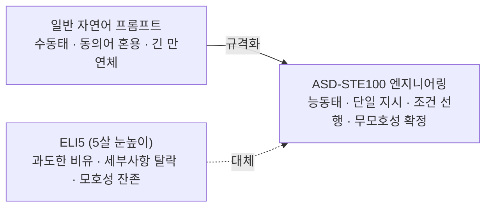

# ASD-STE100 프롬프트 표준: 항공 정비 규격을 활용한 LLM 무모호성 지시 및 인터랙티브 산출물 엔지니어링

## 1. 개요 및 설계 철학

많은 사용자들이 LLM에게 쉬운 설명을 요구할 때 흔히 `"내가 5살인 것처럼 설명해줘(Explain like I'm 5 / ELI5)"`라는 프롬프트를 사용한다. 그러나 복잡한 소프트웨어 아키텍처, 인프라 운영, 항공·의료·금융 등 고위험 엔지니어링 환경에서 ELI5는 핵심적인 기술적 인과관계를 과도하게 생략하거나 부정확한 비유로 인해 치명적인 오해를 초래한다.

전 테슬라 AI 디렉터이자 OpenAI 창립 멤버인 **안드레 카파시(Andrej Karpathy)**는 LLM의 지시 및 설명 품질을 극대화하기 위한 정밀 프롬프트 기법으로 **ASD-STE100(Simplified Technical English)** 표준을 채택할 것을 제안하였다.

ASD-STE100은 항공기 정비 작업자가 복잡한 유지보수 매뉴얼을 읽고 지시를 잘못 이해하여 대형 사고가 발생하는 것을 방지하기 위해 제정된 항공우주 국제 영어 표준이다. 핵심 철학은 **"문장을 유려하거나 아름답게 쓰지 말고, 다르게 해석될 가능성(Ambiguity)을 원천 차단하라"**는 것이다.



---

## 2. ASD-STE100 기반 무모호성 8대 프롬프트 규칙

LLM에 시스템 프롬프트 또는 답변 서식으로 주입할 수 있는 8대 원칙은 다음과 같다:

| 번호 | 핵심 원칙 | 설명 및 나쁜 예 (Bad) | ASD-STE100 권장 예 (Good) |
| :--- | :--- | :--- | :--- |
| **1** | **능동태 명시** | 누가 무엇을 수행해야 하는지 행위의 주체를 명확히 한다. | "설정이 변경된 후 재시작이 수행됩니다." | "엔지니어는 설정을 저장하세요. 시스템 데몬을 다시 시작하세요." |
| **2** | **1문장 1지시** | 한 문장에는 원칙적으로 단 하나의 행동만 기술한다. | "캐시를 비우고 서버를 껐다 켜서 로그를 확인하세요." | "1. 캐시를 비우세요.<br/>2. 서버를 중지하세요.<br/>3. 서버를 시작하세요." |
| **3** | **명칭의 일관성** | 문맥을 풍부하게 하려고 동의어를 쓰지 않고 동일 고유명사를 고정한다. | 처음에 '버튼'이라 했다가 '아이콘', '위젯'으로 번갈아 지칭 | 전체 문서에서 일관되게 '버튼(Button)'으로 고정 |
| **4** | **명사 나열 금지** | 3개 이상의 명사를 길게 이어 붙이지 않고 관계 전치사로 푼다. | "서버 데이터베이스 연결 풀 타임아웃 오류" | "서버의 데이터베이스 연결 풀에서 발생한 타임아웃 오류" |
| **5** | **단순 시제 유지** | 복잡한 완료 시제나 -ing 동명사/분사 구문을 배제한다. | "작업을 수행하면서 데이터를 스트리밍하고..." | "데이터를 전송하세요. 데이터 전송이 끝나면 작업을 시작하세요." |
| **6** | **조건 선행 원칙** | 언제 행동해야 하는지 조건을 문두에 먼저 명시한다. | "디스크 용량이 부족하면 캐시를 지우세요." | **"If 디스크 용량이 90% 이상이면, 캐시를 삭제하세요."** |
| **7** | **세로 목록화** | 복잡한 절차나 다중 조건은 만연체 줄글 대신 세로 글머리 기호로 분할. | 쉼표로 연결된 긴 복합문 | 수직 넘버링 또는 불릿 리스트 |
| **8** | **전문용어 보존** | 해당 도메인의 표준 기술 명사/동사(Technical Terms)는 임의 치환 금지. | '쿠버네티스 파드'를 '작은 프로그램 컨테이너 상자'로 순화 | 'Kubernetes Pod', 'OOMKilled' 등 표준 용어 그대로 유지 |

---

## 3. 텍스트를 넘어선 멀티모달·인터랙티브 산출물 확장

카파시는 ASD-STE100 원칙의 정밀성이 텍스트에서 멈추지 않고, 인간이 AI의 결과물을 검증하는 인지 부하를 줄이기 위해 **상위 모달리티의 산출물(Artifacts)**로 확장되어야 한다고 강조한다:

```
[텍스트 줄글 설명]
      ▼ (이해도 향상 1단계)
[구조 도표 / Mermaid 차트] : "구성 요소와 데이터 흐름을 다이어그램으로 보여줘."
      ▼ (이해도 향상 2단계)
[인터랙티브 HTML 웹페이지] : "파라미터 슬라이더를 직접 움직여 시뮬레이션할 수 있는 HTML을 작성해줘."
      ▼ (이해도 향상 3단계)
[3Blue1Brown 스타일 영상]  : "수식과 벡터 회전을 Manim 기반 설명 코드로 시각화해줘."
```

---

## 4. 인간 참여(HITL) 의사결정 트리 및 AUQ 패턴

바이브 코딩(Vibe Coding)이나 복합 에이전트 워크플로우 도중, LLM이 불확실성을 해소하기 위해 사용자에게 주관식 질문을 장황하게 던지는 현상이 빈번히 발생한다. 이때 ASD-STE100 철학을 적용한 해결 패턴:

1. **의사결정 평가표(Decision Matrix) 재구성**:
   - 주관식 질문 대신, 선택 가능한 후보군과 트레이드오프(성능, 비용, 보안, 구현 난이도)를 비교표로 정형화.
2. **AUQ (Ask User Questions) 결정 트리 탐색**:
   - 사용자가 객관식 선택지만 클릭하면 즉시 분기가 확정되도록 닫힌 질문(Closed-ended questions) 체계로 전환.

---

## 5. 실전 프롬프트 템플릿 예시

```markdown
당신은 엄격한 항공 엔지니어링 표준 ASD-STE100을 준수하는 테크니컬 리드입니다.
다음 지침에 따라 아래 시스템 장애 복구 절차서를 작성하세요:

1. 모든 지침은 능동태 단문으로 작성하세요.
2. 한 문장에는 오직 하나의 조치(Action)만 기술하세요.
3. 조건문은 반드시 문장의 첫머리에 "If [조건], [조치]." 형식으로 배치하세요.
4. 기술 용어(Kubernetes, DNS, CIDR, TLS)는 임의의 일상어로 바꾸지 마세요.
5. 절차서 마지막에는 시스템 아키텍처 상태 전이를 나타내는 Mermaid sequenceDiagram을 반드시 포함하세요.
```

---

## 🔗 관련 문서 링크
- [[wiki/Engineering/Prompt-Engineering/Karpathy-Agentic-Engineering-Lifecycle.md]] — 카파시의 에이전트 엔지니어링 라이프사이클
- [[wiki/Engineering/Prompt-Engineering/Agent-Filesystem-Context-Engineering.md]] — 에이전트 파일시스템 컨텍스트 엔지니어링
- [[wiki/Engineering/Prompt-Engineering/000_Prompt-Engineering-MOC.md]] — 프롬프트 엔지니어링 MOC 색인
- [[wiki/Engineering/AI-Native-Engineering/Epistemic-Debt-ChangeScore-Friction-Gate.md]] — 에피스테믹 부채 통제 게이트
