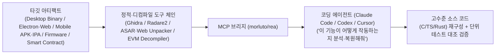

# REA (Reverse Engineer Anything): MCP 기반 에이전틱 역공학 파이프라인과 AI 시대 소프트웨어 해자(Moat) 전략

## 1. 핵심 요약 (Executive Summary)
**REA (Reverse Engineer Anything, `morluto/rea`)**는 기존에 숙련된 리버싱 엔지니어가 수주간 수동으로 수행하던 바이너리·애플리케이션 역공학(Reverse Engineering) 도구를 **MCP(Model Context Protocol) 및 에이전트 스킬로 통합하여 Claude Code, Codex, Cursor 등의 코딩 에이전트가 자율적으로 실행 파일에서 원본 소스 코드를 복원**하게 만든 오픈소스 프로젝트다.

고전 게임 **DX-Ball** 사례에서 효과음 발생 지점부터 오디오 패닝 계산 로직까지 역추적해 **3,205개 테스트를 100% 통과하고 재컴파일 시 원본과 바이트 단위까지 일치(Byte-identical)하는 C 코드를 복원**함으로써, 비공개 바이너리에 의존하던 기존 소프트웨어 보안 및 비즈니스 해자(Moat) 패러다임에 근본적 전환을 촉발했다.

---

## 2. REA의 아키텍처 및 분석 대상 범위

### 2.1 다중 플랫폼 분석 범위
1. **데스크톱 네이티브 바이너리**: 디스어셈블러·디컴파일러를 MCP로 연결하여 기계어를 사람이 읽을 수 있는 고수준 C/C++ 코드로 재구조화한다.
2. **웹 기술 기반 데스크톱 앱 (Notion, Electron 등)**: 별도 저수준 디컴파일 없이 번들 언패킹만으로 내부 구조와 상태 관리 로직을 즉시 전개한다.
3. **모바일 앱 · 가전 펌웨어 · 블록체인 스마트 컨트랙트**: 스마트폰 앱 패키지, 임베디드 펌웨어, 온체인 바이트코드까지 동일한 자연어 질의로 기능을 역추적한다.

### 2.2 DX-Ball 바이트 일치(Byte-Identical) 복원 사례
- 공의 화면 좌우 위치에 따라 좌우 스피커 볼륨을 조절하는 스테레오 패닝 로직을 효과음 호출 지점부터 역추적하여 C 언어로 완전 복원했다.
- 복원된 코드는 **3,205개 검증 테스트에서 원본과 동일한 결과**를 출력했으며, **재컴파일된 바이너리까지 원본과 바이트 하나 틀리지 않고 일치**했다.

---

## 3. 보안 공학적 한계 분석 및 잠재적 위협 (Red-Team Perspective)

### 3.1 현행 오픈소스 REA의 기술적 한계
- **정적 리버싱 도구의 MCP 래퍼**: 현재 공개된 REA는 기존 정적 분석 도구들을 MCP로 묶어 에이전트 루프에 연결한 형태다.
- **상용 난독화·가상화 보호 우회 불가**: **VMProtect**와 **Themida** 같은 다중 보호 및 코드 가상화(Virtualization)가 적용된 상용 바이너리는 정적 MCP 도구만으로 분석하기 어렵다.
- **런타임 메모리 덤프 부재**: 현 버전에는 비공식 커널 드라이버를 수동 매핑(Manual Mapping)하여 실행 중인 프로세스의 복호화된 런타임 메모리를 덤프하는 동적 분석 기능은 포함되어 있지 않다.

### 3.2 진입장벽 붕괴와 향후 위험 시나리오
- 과거에는 리버싱 전문 지식이 없는 개발자가 바이너리 분석을 시도조차 할 수 없었으나, 바이럴된 에이전트 스킬을 통해 누구나 자연어로 역공학을 시도할 수 있게 되었다.
- 만약 향후 오픈소스 생태계나 공격자 포크에 **커널 레벨 런타임 덤프 + 동적 트레이싱 MCP**까지 결합될 경우, 일반 상용 소프트웨어의 클라이언트 로직 은닉은 사실상 무력화된다.

---

## 4. AI 리버싱 시대의 방어 엔지니어링 및 비즈니스 해자(Moat) 전략

1. **출시 전 에이전틱 레드팀 자가 감사 (Pre-Release AI Reversing Audit)**:
   - 소프트웨어를 배포하기 전에 개발팀 스스로 REA 등 AI 리버싱 에이전트를 가동하여 자사 바이너리를 공격·역공학해 보고, 핵심 알고리즘이나 시크릿이 복원되지 않을 때까지 난독화·서버사이드 이전·가상화를 강화한 뒤 출시해야 한다.
2. **소프트웨어 해자(Moat)의 이동**:
   - 지금까지 소프트웨어를 지켜준 것은 '비공개 코드' 자체가 아니라 **'경쟁자가 분석하는 데 걸리는 시간(수주~수개월)'**이었다. 에이전트가 이 시간을 며칠 이내로 압축함에 따라, 단순 클라이언트 기능 구현만으로는 방어막을 유지할 수 없다.
   - **지속 가능한 해자**: 역공학으로 복제할 수 없는 **축적된 독점 데이터(Proprietary Data), 대규모 인프라 운영 경험, 고객 신뢰 및 규제 준수, 그리고 물리적 환경(Physical AI/하드웨어)과의 결합**으로 핵심 가치를 이동해야 한다.

---

## 5. 관련 문서 (Cross-References)
- [[wiki/Engineering/Data-and-Security/000_Data-and-Security-MOC.md]]
- [[wiki/Engineering/Security/Heimel-Consequence-Time-Authorization-Infrastructure.md]]
- [[wiki/Agents/Coding-and-Engineering/Pstack-Tstack-and-Cumulative-Diff-Verification-Workflows.md]]
- [[wiki/Engineering/AI-Native-Engineering/The-End-of-Software-Engineering-Intent-Architecture.md]]
