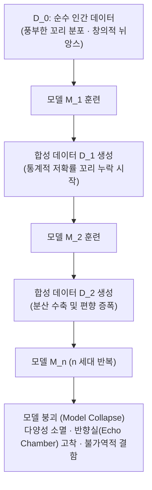

# 모델 붕괴(Model Collapse): 합성 데이터 재귀 학습의 구조적 결함 및 꼬리 분포 소멸 메커니즘

## 1. 개요 및 정의

인터넷 텍스트의 상당수가 생성형 AI(ChatGPT, Claude 등)에 의해 생산되면서, 차세대 대형 언어 모델이 이전 세대 AI가 생성한 합성 데이터(Synthetic Data)를 재귀적으로 스크래핑·학습하는 순환 루프가 현실화되고 있다.

옥스퍼드(Oxford) 대학교와 케임브리지(Cambridge) 대학교 연구진(Shumailov et al., *Nature* 2024)은 미래의 AI 모델(예: $M_{n+1}$)이 이전 세대 모델($M_n$)의 출력을 바탕으로 반복 학습을 진행할 때 발생하는 불가역적 성능 붕괴 현상을 이론적·실험적으로 규명하고 이를 **모델 붕괴(Model Collapse)**로 명명하였다.

---

## 2. 모델 붕괴의 2단계 진행 과정

모델 붕괴는 단일 세대에서 급작스럽게 발생하지 않고 세대를 거듭하며 누적 진행된다:

### 2.1. 1단계: 초기 붕괴 (Early Collapse / Tail Loss)
- **분포 꼬리(Tails)의 소실**: 자연어 데이터의 핵심 특성인 지프의 법칙(Zipf's Law) 상에서 출현 빈도가 낮은 희귀 어휘, 특수 전문 도메인 지식, 다면적 뉘앙스가 모델 생성 샘플링 단계에서 누락된다.
- **표면적 유창성 유지**: 흔한 패턴에 대한 문법적 유창성은 유지되므로 벤치마크 점수 상으로는 결함이 은폐되기 쉽다.

### 2.2. 2단계: 후기 붕괴 (Late Collapse / Mode Collapse)
- **분산의 급격한 수축 (Variance Shrinkage)**: 생성된 데이터의 엔트로피가 급감하며, 데이터 분포가 가장 높은 최빈값(Mode) 주위로 축소된다.
- **반향실(Echo Chamber) 고착**: 모델은 소수의 정형화된 표현만을 무한 반복하며, 이전 세대의 사소한 오류나 왜곡이 세대를 거치며 기하급수적으로 증폭되어 본래 인간 언어 분포와의 쿨백-라이블러 발산($D_{\text{KL}}$)이 무한대로 발산한다.

---

## 3. 이론적 수학 모델 (GMM 기반 증명)

연구진은 가우시안 혼합 모델(Gaussian Mixture Models, GMM)과 변분 자동인코더(VAE)를 통해 모델 붕괴가 디코더 트랜스포머뿐만 아니라 모든 생성 모델 계열에서 보편적으로 성립하는 수학적 필연임을 증명하였다:

참된 데이터 분포를 $p_0(x)$라 하고, 세대 $n$의 모델 매개변수를 $\theta_n$, 추정된 분포를 $q(x \mid \theta_n)$이라 할 때:
1. **표본 추출 오차 (Statistical Error)**: 유한한 샘플 크기 $N$으로 인해 매 세대마다 몬테카를로 추정 편향 발생.
2. **함수 근사 오차 (Functional Approximation Error)**: 신경망의 유한한 표현력으로 인해 참 분포의 지지 집합(Support)이 손실됨.

세대가 진행됨에 따라 분포의 분산 $\sigma_n^2$은 다음과 같은 점화식을 따르며 0으로 수렴한다:
$$\sigma_{n+1}^2 = \sigma_n^2 \left(1 - \frac{1}{N}\right) \implies \lim_{n \to \infty} \sigma_n^2 = 0$$
즉, 외부로부터 새로운 원천 엔트로피(신규 인간 데이터 또는 환경 피드백)가 주입되지 않는 한, 재귀 학습 시스템은 반드시 점 질량(Point Mass)으로 붕괴한다.

---

## 4. 유사 개념과의 비교 분석

| 비교 항목 | 파국적 망각 (Catastrophic Forgetting) | 데이터 중독 (Data Poisoning) | 모델 붕괴 (Model Collapse) |
| :--- | :--- | :--- | :--- |
| **발생 원인** | 새 도메인 학습 시 이전 태스크 가중치 덮어씀 | 악의적 공격자가 주입한 의도적 노이즈 | **이전 세대 모델이 스스로 왜곡한 데이터의 재학습** |
| **작동 환경** | 지속적 학습 (Continual Learning) | 적대적 공격 (Adversarial Attack) | **합성 데이터 중심 사전학습 (Pretraining)** |
| **복구 가능성** | 리플레이 버퍼나 LoRA 격리로 복구 용이 | 오염 데이터 정제 시 복구 가능 | **꼬리 정보가 완전히 소실되어 비가역적(Irreversible)** |
| **파괴 대상** | 이전 태스크 성능 | 타깃 클래스 정합성 | **데이터 분포 전체의 표현 다양성 및 창의성** |

---

## 5. 모델 붕괴 방지 및 극복 전략

### 5.1. 원천 데이터 계보 추적 및 워터마킹 (Data Provenance & Watermarking)
- 웹 스크래핑 파이프라인에서 AI 생성 텍스트를 감지하여 사전학습 코퍼스에서 배제하거나 가중치를 낮춤.
- 인간 작성 정본 데이터셋(Human-authored Golden Sets)을 별도 아카이브로 영구 보존.

### 5.2. 환경 접지 기반 자가 대전 (Self-Play Grounding with Zero Data)
- 단순 자연어 모방(Unsupervised Imitation)은 모델 붕괴를 피할 수 없으나, 실행 가능한 환경(Executable Environment)과 수학적 검증자(Verifier)가 결합된 자기대전 시스템은 모델 붕괴를 원천 방지한다.
- `[[wiki/Models/RL/Self-Play-Pretraining-Zero-Data.md]]`: 보편 튜링 기계(UTM) 상에서 구동되는 프로그램 바이트와 학습 진행 보상(Learning-Progress Reward)을 결합하여 무(無)데이터 상태에서도 붕괴 없이 거듭제곱 법칙을 실현.

### 5.3. 꼬리 분포 필터링 미세조정 (TailSFT)
- `[[wiki/Models/SFT/TailSFT-Filtered-Fine-Tuning.md]]`: 데이터셋에서 고빈도 중앙값 샘플을 의도적으로 제거하고, 희귀 꼬리(Tail) 샘플의 손실 가중치를 증폭시켜 표현 붕괴를 상쇄.

---

## 🔗 관련 문서 링크
- [[wiki/Models/RL/Self-Play-Pretraining-Zero-Data.md]] — 무데이터 자기대전 사전학습과 모델 붕괴 회피 기법
- [[wiki/Models/SFT/TailSFT-Filtered-Fine-Tuning.md]] — 희귀 꼬리 데이터 보존 필터링 미세조정
- [[wiki/Models/Architectures/000_Architectures-MOC.md]] — 모델 아키텍처 색인
- [[wiki/Models/RL/Xiaomi-MiMo-Open-RL-Task-Environments.md]] — 실행 환경 기반 RL 학습장
