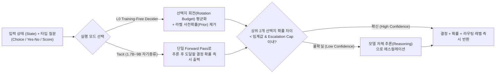

# System One 결정 모델 생태계 심층 분석: AnyJev, Tacit, Jeva, Unsloth 파인튜닝 및 리랭커 한계

## 1. 핵심 요약 (Executive Summary)
자유 형식 텍스트를 생성하는 대신 입력 상태(State)와 타입화된 질문(Typed Question)에 대해 **단일 패스로 보정된 선택 확률(Calibrated Probability)을 반환하는 System One 결정 모델([[wiki/Agents/Frameworks/TypeSafe-Jev-System-One-Decision-Architecture.md|Jev]] 계열)** 생태계가 급격히 확장되고 있다. 본 문서는 최신 4대 기술 축과 아키텍처 경계를 종합한다.
1. **Nokia `AnyJev` & `Tacit`**: 별도 학습 없이 임의의 오픈소스 Causal LLM에서 선택지 순환 회전(Cyclic Rotation)과 라벨 사전확률 나눗셈(Label Prior Division)으로 위치·라벨 편향을 제거하는 **L0 Training-Free Decider**와, 추론 후 도달할 결정을 1회 순전파로 자기 증류한 **`Tacit` (1.7B~9B)** 체크포인트 및 조건부 추론 에스컬레이션 서버를 제공한다.
2. **`Jeva` (결정 네이티브 강건 아키텍처)**: 기존 System One 모델이 간과했던 4대 구조적 요구사항(**Null-aware**, **Permutation-invariant**, **Option-scalable**, **Cross-request Cacheable**)을 동시에 해결하여 수천 개 후보군에서도 결정 뒤집힘(Flip) 없이 초저지연 추론을 달성한다.
3. **Unsloth `Qwen3.5-4B` 결정 모델 파인튜닝 및 선택지 확장 병목**: 일반 자기회귀 LLM을 LoRA와 홀드아웃 확률 보정(Held-out Calibration)으로 결정 모델화하는 파이프라인과, 선택지 개수가 5개에서 77개로 늘어날 때 발생하는 보정 붕괴 경계를 규명한다.
4. **결정 모델 vs 리랭커(`System One Models Are Not Better Rerankers`)**: Qwen 0.6B~27B 백본과 10개 TREC DL·BEIR 벤치마크 실측 결과, **0.6B~9B 전 구간에서 전용 리랭커(Cross-Encoder) 파인튜닝이 결정 모델 파인튜닝을 `nDCG@10` 기준 5~29점 압도**하며, 리랭킹 용도로는 결정 파인튜닝이 무의미함이 입증되었다.

---

## 2. Nokia `AnyJev` & `Tacit`: 무학습 로짓 보정과 자기 증류 결정 모델

### 2.1 왜 단순 Next-Token Logit 읽기는 실패하는가?
오픈 LLM에게 선택지(`A, B, C`)를 주고 다음 토큰 로짓(Logit)을 바로 읽으면 두 가지 치명적 결함이 발생한다.
1. **선택지 순서 편향(Position/Order Bias)**: 선택지 배치 순서만 바꿔도 모델의 최고 확률 선택이 뒤집힌다.
2. **라벨 사전 편향(Label Prior Bias)**: 모델이 내용과 무관하게 특정 알파벳이나 토큰 라벨을 선호하는 내재적 편향을 갖는다.

### 2.2 `AnyJev` L0 Training-Free Decider & `Tacit` 아키텍처

- **적응형 회전 예산(Calibrated Rotation Budget)**: 모든 순열을 다 돌리는 대신, 라벨 없이 보정된 정지 임계값(Stopping Threshold)에 도달할 때까지만 선택지 회전을 수행하여 연산량을 최소화한다.
- **`Tacit` 자기 증류 체크포인트 (1.7B ~ 9B)**: 원본 모델이 긴 Chain-of-Thought 추론 끝에 내리는 최종 결정을 **단 한 번의 Forward Pass**로 재현하도록 자기 증류(Self-distillation)된 Hugging Face 체크포인트다.
- **상한 기반 추론 에스컬레이션(Capped Escalation)**: 상위 2개 후보의 확률이 근접한 불확실 결정만 전체 추론(Reasoning)으로 에스컬레이션하며, 사용자가 지정한 비율 상한(Escalation Cap)을 여러 클라이언트가 단일 HTTP 엔드포인트에서 공유할 수 있다.
- **지원 백엔드**: `Transformers`, 인프로세스/서버 `vLLM`, `SGLang`, 그리고 GGUF 양자화 모델을 위한 `llama.cpp`를 모두 지원한다.

---

## 3. `Jeva`: 대규모 후보군을 위한 4대 구조적 강건성 아키텍처
기존 System One 결정 모델의 한계를 극복하기 위해 **Jeva**는 다음 4가지 구조적 속성을 아키텍처 수준에서 보장한다([[wiki/Models/Optimization-and-Serving/CLM-Choice-Language-Model.md|CLM-8B]] 참조).

| 구조적 요구사항 | 기존 결정 모델의 한계 | `Jeva` 아키텍처 해법 및 효과 |
| :--- | :--- | :--- |
| **1. Null-Aware (정답 부재 식별)** | 후보 중 정답이 없는 상태(Absence)와 후보 간 불확실성(Uncertainty)을 구분하지 못함 | 정답 부재 상태를 명시적 공간으로 분리하여 **거의 완벽한 Null 탐지율** 달성 |
| **2. Permutation-Invariant (순열 불변성)** | 선택지 순서 변경 시 결정이 뒤집히는 현상 발생 | 테스트된 **모든 순열 조합에서 결정 뒤집힘(Decision Flip) 0건** 보장 |
| **3. Option-Scalable (선택지 확장성)** | 후보군이 늘어나면 출력 공간을 재정의해야 하거나 성능이 급락함 | 출력 공간 재정의 없이 **수천 개의 후보군(Thousands of candidates)**으로 즉시 확장 |
| **4. Cacheable (교차 요청 캐싱)** | 반복 등장하는 후보 설명도 매 요청마다 다시 인코딩함 | 요청 독립적인 후보군 연산을 **요청 간 캐싱·재사용**하여 결정 변화 없이 지연 시간 대폭 단축 |

---

## 4. Unsloth `Qwen3.5-4B` 결정 모델 파인튜닝과 실무 주의점
- **Unsloth Colab 워크플로**: 일반 자기회귀 모델인 `Qwen3.5-4B`에 LoRA를 적용하여 타입화된 결정 데이터셋으로 학습시킨 뒤, **홀드아웃 데이터셋(Held-out Data)에서 출력 확률을 사후 보정(Calibration)**하는 엔드투엔드 파이프라인을 제공한다.
- **실무 함정 1 — 라벨 세트 크기(Option Count) 확장 한계**: 일반 LLM을 파인튜닝한 결정 모델은 선택지가 5개 내외일 때는 높은 정확도를 보이지만, 선택지가 77개 수준으로 늘어나면 정확도가 `0.42` 수준으로 급락하는 경향이 있다. 대규모 후보군 라우팅에는 `Jeva`나 `CLM-8B` 같은 후보 분리 인코딩 구조가 필요하다.
- **실무 함정 2 — 비즈니스 확률 해석과 고전 분류기 대비 비용**: Strands Decider 파일럿 실험(72개 케이스)에서 드러나듯, 출력 확률 분포를 애플리케이션 임계값으로 어떻게 해석하느냐에 따라 우선순위 판정이 크게 달라지며, 단순 정형 분류 작업에 무작정 LLM 백본을 태우는 것은 고전 인코더/분류기([[wiki/Models/Optimization-and-Serving/GLiNER2.5-Decide-Structured-Decision-Encoder.md|GLiNER2.5-Decide]] 등) 대비 연산 낭비가 될 수 있다.

---

## 5. 결정 모델 vs 리랭커: *System One Models Are Not Better Rerankers*
Michael Dinzinger의 연구는 Qwen `0.6B ~ 27B` 6개 백본과 10개 정보 검색 벤치마크(TREC DL, BEIR)에서 **(1) 제로샷 베이스 모델**, **(2) 결정 모델 파인튜닝(Decision Fine-tune)**, **(3) 전용 리랭커 파인튜닝(Reranker Fine-tune)**을 정량 비교했다.

1. **0.6B ~ 9B 전 구간에서 전용 리랭커 파인튜닝의 압승**:
   - 모든 백본(0.6B~9B)과 제로샷 컬렉션에서 리랭커 파인튜닝이 결정 모델 파인튜닝을 **`nDCG@10` 기준 +5점 ~ +29점** 차이로 압도했다(27B에서만 동률).
   - 9B 이하에서는 결정 모델 파인튜닝이 아예 파인튜닝하지 않은 제로샷 베이스 모델 대비 **아무런 랭킹 이점도 추가하지 못했다**.
2. **프롬프트 민감성에 취약한 확률 보정(Calibration)**:
   - *"이 패시지가 질문에 답하는가?"*라는 특정 질문 형식에서는 4B 이상 결정 모델이 리랭커보다 확률 보정(Calibration)이 우수했으나, 선행 연구의 약간 다른 질문 문구로 바꾸자 보정 우위가 즉시 사라졌다.
3. **결론 (설계 원칙)**:
   - 보정(Calibration)이 나쁜 순위(Ranking)를 만회해주지 못한다. 고정 임계값 필터링에서도 9B 이하 구간은 전용 리랭커가 항상 더 우수한 문서를 남긴다. **리랭커가 필요하면 결정 모델을 전용하지 말고 전용 리랭커를 파인튜닝해야 한다.**

---

## 6. 관련 문서 (Cross-References)
- [[wiki/Agents/Frameworks/TypeSafe-Jev-System-One-Decision-Architecture.md]]
- [[wiki/Agents/Evaluations/JevAdvBench-Decision-Model-Adversarial-Benchmark.md]]
- [[wiki/Models/Optimization-and-Serving/CLM-Choice-Language-Model.md]]
- [[wiki/Models/Optimization-and-Serving/GLiNER2.5-Decide-Structured-Decision-Encoder.md]]
- [[wiki/Agents/Evaluations/Judge-Model-Comparison.md]]
- [[wiki/Models/Optimization-and-Serving/000_Optimization-and-Serving-MOC.md]]
