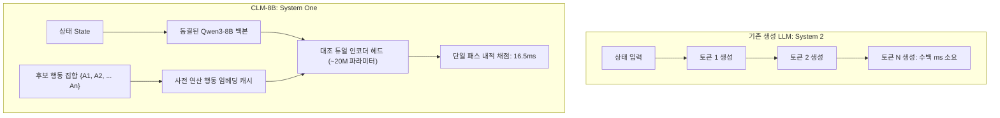

# CLM-8B: Stanford와 NVIDIA의 오픈소스 시스템 1(System One) 선택 언어 모델

## 1. 개요 및 탄생 배경

전통적인 자기회귀(Autoregressive) 생성 언어 모델은 다음 토큰을 순차적으로 생성(Token-by-Token Decoding)하므로, 단순한 옵션 선택이나 라우팅과 같은 의사결정 작업에서도 수백 밀리초에서 수 초에 달하는 지연 시간(Latency)과 막대한 연산 비용을 소모한다.

2026년 9월, **Stanford University와 NVIDIA** 연구진은 TypeSafe AI의 독점 상용 모델인 Jev에 대응하여, 완전 오픈소스 가중치(Apache 2.0 라이선스)로 구동되는 시스템 1(System One) 의사결정 모델인 **CLM-8B (Contrastive / Choice Language Model)**을 발표하였다.

CLM-8B는 텍스트를 생성하지 않고, 현재 상태(State)와 사전에 정의된 후보 행동(Actions/Choices)을 단일 포워드 패스로 대조 채점(Contrastive Scoring)하여 최적의 옵션을 즉각 선별한다.



---

## 2. 아키텍처 및 핵심 메커니즘

### 2.1. 동결 백본 + 경량 프로젝션 헤드 구조
- **백본**: 대규모 사전학습된 **Qwen3-8B** 모델 가중치를 완전히 동결(Frozen)하여 사용한다.
- **프로젝션 헤드**: 의사결정 태스크별로 약 **2,000만 개(~20M)의 파라미터**만을 갖는 경량 대조 프로젝션 헤드를 학습시킨다.
- **파인튜닝 효율성**: 전체 가중치를 미세조정할 필요 없이 헤드만 학습하므로, 단일 상용 GPU(RTX 4090/A100)에서도 저비용으로 도메인 특화 결정 헤드를 훈련 및 교체할 수 있다.

### 2.2. 상태-행동 분리와 임베딩 캐싱 (Action Disaggregation)
기존 LLM 프롬프트에 후보 선택지 목록 전체를 매번 주입하는 방식과 달리, CLM-8B는 상태 인코더와 행동 인코더를 분리한다:
1. 에이전트가 호출 가능한 도구 목록(Tools), API 엔드포인트, 분류 카테고리 등 고정된 후보군에 대해 **행동 임베딩(Action Embeddings)을 1회 사전 계산하여 캐싱**해 둔다.
2. 런타임에는 실시간 상태(State)만 인코딩하여 캐싱된 행동 임베딩들과 행렬 곱(Dot-product)을 수행하므로 연산량이 $O(N)$에서 $O(1)$에 가깝게 단축된다.

---

## 3. 3대 결정 인터페이스

CLM-8B는 TypeSafe Jev의 3대 결정 프리미티브 규격을 그대로 호환하도록 설계되었다:

| 인터페이스 | 반환 값 | 주요 활용 사례 |
| :--- | :--- | :--- |
| **`Choice`** | 단일 최적 후보 라벨 및 확률 분포 | 에이전트 도구 선택, 고객 문의 라우팅, 에러 분류 |
| **`Noul`** | 명제의 참/거짓 확률 ($P(\text{True}) \in [0.0, 1.0]$) | PR 자동 승인 여부, 보안 탈옥 검사, 가드레일 |
| **`Score`** | 순서형 루브릭 상의 기대 수준 (연속 점수) | 변경 심각도 채점, 긴급도 측정, RAG 관련성 평가 |

---

## 4. 성능 벤치마크 및 비교

### 4.1. TypeSafe Jev 대비 성능 및 속도

| 평가 항목 | TypeSafe Jev (독점 API) | Stanford + NVIDIA CLM-8B (Apache 2.0) |
| :--- | :--- | :--- |
| **단일 결정 지연 시간** | 149.8 ms (T-Rex 게임 기준) | **16.5 ms (최대 9배 가속)** |
| **1,000개 후보 선택 지연** | 약 650 ms | **약 50 ms (최대 13배 가속)** |
| **도구 호출 정확도 (BFCL v4)** | **99.2%** | 95.2% |
| **코딩 에이전트 벤치 (DeepSWE)** | - | **81.6%** |
| **터미널 실행 벤치 (Terminal-Bench 2.1)** | - | **87.6%** |
| **배포 및 라이선스** | 독점 클라우드 API 전용 | **Apache 2.0 오픈소스 가중치, 온프레미스 자체 호스팅** |

> [!NOTE]
> 복잡한 도구 호출 인자 유효성 검증(BFCL v4)에서는 여전히 상용 Jev가 99.2%로 소폭 앞서지만, 터미널 명령 선택 및 코딩 에이전트 궤적 제어에서는 CLM-8B가 압도적인 속도(16.5ms)와 강력한 정확도를 입증하였다.

---

## 5. 실전 서빙 및 파이썬 구현 가이드

### 5.1. 사전 계산 임베딩 기반 초고속 도구 라우터

```python
import torch
import torch.nn.functional as F
from clm import CLMModel, CLMTokenizer

# 1. 모델 로드 (동결 백본 + 헤드)
tokenizer = CLMTokenizer.from_pretrained("stanford-oval/clm-8b")
model = CLMModel.from_pretrained("stanford-oval/clm-8b", torch_dtype=torch.bfloat16).cuda()

# 2. 후보 액션 집합 사전 캐싱 (1회 연산)
candidate_tools = [
    "bash_run: execute terminal shell commands",
    "git_checkout: switch git branches or restore working tree",
    "file_read: read text content from local filesystem",
    "file_write: write modified content to files",
    "web_search: perform internet search query",
    "escalate_to_human: request human intervention"
]

with torch.no_grad():
    tool_tokens = tokenizer(candidate_tools, padding=True, return_tensors="pt").to("cuda")
    action_embeddings = model.encode_actions(tool_tokens) # [N, D]

# 3. 런타임 상태 단일 패스 평가 (16.5ms)
current_state = "Error: git repository has merge conflicts in INDEX.md. Resolve conflicted marks."
state_tokens = tokenizer([current_state], return_tensors="pt").to("cuda")

with torch.no_grad():
    state_emb = model.encode_state(state_tokens) # [1, D]
    logits = torch.matmul(state_emb, action_embeddings.T) # [1, N]
    probs = F.softmax(logits, dim=-1)
    
best_tool_idx = torch.argmax(probs, dim=-1).item()
confidence = probs[0, best_tool_idx].item()

print(f"Selected: {candidate_tools[best_tool_idx]} (Confidence: {confidence:.4f})")
```

---

## 6. 에이전틱 아키텍처 내 배치 패턴

1. **JEV-as-a-Judge 오픈소스 구현**:
   - `[[wiki/Agents/Frameworks/TypeSafe-Jev-System-One-Decision-Architecture.md]]`의 에스컬레이션 캐스케이드를 CLM-8B로 대체하여 외부 API 호출 없이 로컬 클러스터 내부에서 1차 심판을 전담.
2. **에이전트 궤적 조기 차단(Early Stopping Gate)**:
   - 에이전트의 터미널 명령 실행 직전 `Noul` 인터페이스를 호출하여 잠재적 치명 명령(`rm -rf`, 자격증명 노출 등)을 20ms 내에 차단.
3. **SGLang 구조화 디코딩과의 결합**:
   - `[[wiki/Models/Optimization-and-Serving/TypeLLM-SGLang-Type-Safe-Generation.md]]`과 병용하여, 라우팅 및 단일 분기는 CLM-8B로 15ms에 처리하고, 복합 JSON 페이로드 생성은 TypeLLM으로 위임.

---

## 🔗 관련 문서 링크
- [[wiki/Agents/Frameworks/TypeSafe-Jev-System-One-Decision-Architecture.md]] — TypeSafe Jev 상용 결정 모델 및 원조 아키텍처
- [[wiki/Models/Optimization-and-Serving/TypeLLM-SGLang-Type-Safe-Generation.md]] — SGLang 기반 타입 보장 생성 프레임워크
- [[wiki/Models/Optimization-and-Serving/GLiNER2.5-Decide-Structured-Decision-Encoder.md]] — 스팬/관계 및 제약 조건 처리 인코더 결정 모델
- [[wiki/Agents/Evaluations/Judge-Model-Comparison.md]] — LLM vs Agent vs Decision Judge 평가 비교
- [[wiki/Models/Optimization-and-Serving/000_Optimization-and-Serving-MOC.md]] — 모델 최적화 및 서빙 색인
