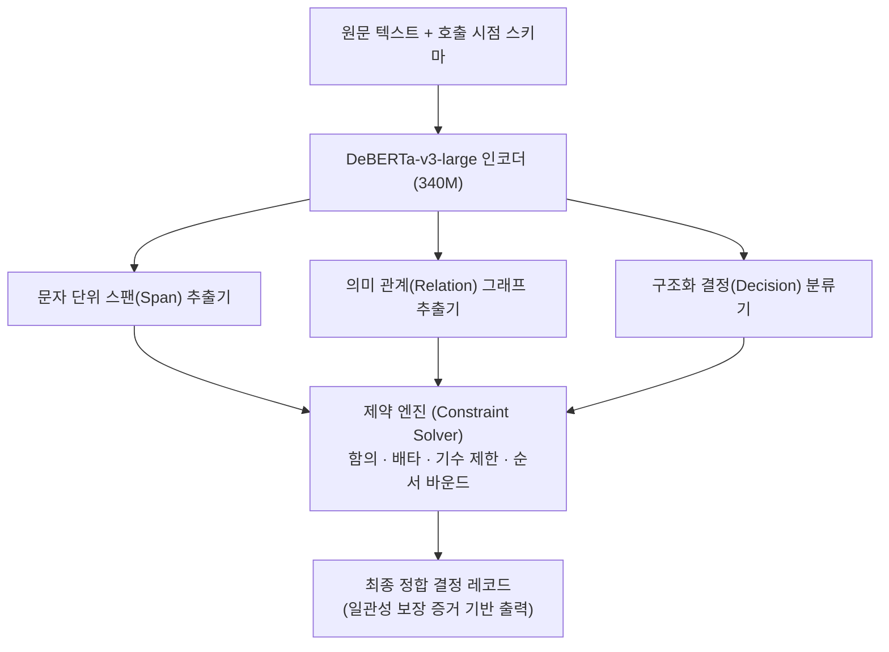

# GLiNER2.5-Decide: Fastino의 스팬·관계 및 제약식 기반 340M 인코더 결정 모델

## 1. 개요 및 설계 철학

프로덕션 에이전트 환경에서 단순 라벨 분류(Classification)를 넘어 실세계 의사결정을 수행하려면, 결정을 뒷받침하는 **증거 텍스트 스팬(Span)**을 추출하고, 엔티티 간 **의미 관계(Relations)**를 파악하며, 상호 연관된 결정들 간의 **논리적 제약 조건(Logical Constraints)**을 엄격히 유지해야 한다.

2026년 9월, **Fastino Labs**(CEO George Hurn-Maloney)가 발표한 **GLiNER2.5-Decide**는 생성형 디코더 모델의 확률론적 불안정성과 지연 시간을 탈피하기 위해 설계된 **3억 4천만(340M) 파라미터 규모의 오픈소스(Apache 2.0) 인코더 기반 의사결정 모델**이다.

DeBERTa-v3-large 아키텍처를 기반으로 구축된 GLiNER2.5-Decide는 고가의 GPU 인스턴스 없이 일반 **CPU 환경에서도 100ms 미만의 지연 시간**으로 구조화된 결정을 내릴 수 있다.



---

## 2. 핵심 아키텍처 및 4대 제약 논리

GLiNER2.5-Decide는 단순 단일 라벨 선택에 그치지 않고, 다중 결정 간의 논리적 모순을 사전에 방지하는 4대 제약 규칙을 내장한다:

1. **함의 조건 (Implications)**:
   - 특정 결정 $A$가 참일 경우, 반드시 종속 결정 $B$가 참이어야 함 ($A \implies B$).
   - 예: "환불 승인" 결정 시 "환불 사유 유효" 결정이 반드시 수반됨.
2. **상호 배타 (Exclusions)**:
   - 두 개 이상의 상반된 라벨이 동시에 활성화되는 것을 금지.
   - 예: "단순 변심"과 "배송 파손"이 동일 건에 대해 충돌할 때 우선순위 규칙 적용.
3. **기수 제한 (Cardinality Limits)**:
   - 선택 가능한 라벨의 최소 및 최대 개수를 엄격히 제한 ($k_{\min} \le |C| \le k_{\max}$).
4. **순서형 바운드 (Ordinal Bounds)**:
   - 심각도(Severity)나 신뢰도 순위에서 하위 결정이 상위 결정을 역전하지 못하도록 상하한선 강제.

---

## 3. 17대 데이터셋 공개 벤치마크 (5,100개 검증 세트)

Fastino 연구진은 개발자가 실제로 결정 모델을 사용하는 실무 워크플로우를 반영하기 위해 17개 도메인 데이터셋 전반에 걸친 5,100개의 미공개(Unseen) 평가 벤치마크를 공개하였다:

- **평가 태스크**: 인텐트 분류, 티켓 라우팅, 보안 트리아지, 감정 분석, 가변 스키마 콘텐츠 이해.
- **엄격한 채점 기준(Exact Match)**: 부분 점수를 배제하고, 모델이 산출한 전체 라벨 집합이 정답 레코드와 100% 완전 일치할 때만 정답으로 인정.
- **결과**: 고비용 70B+ 생성 LLM 대비 동등 이상의 완전 일치율을 기록하면서도, CPU 서빙을 통해 **운영 비용을 98% 이상 절감**하고 처리량을 수십 배 향상시켰다.

---

## 4. 실전 파이썬 코드 예제

```python
from gliner_decide import GLiNERDecide
import json

# 1. Hugging Face에서 340M 모델 로드 (CPU에서도 초고속 실행)
model = GLiNERDecide.from_pretrained("fastino/GLiNER2.5-Decide")

# 2. 분석 대상 텍스트
text = "결제 승인 직후 서버 500 에러가 발생하면서 계좌에서 120,000원이 인출되었습니다. 즉시 취소 및 결제 취소 영수증 발행 요청합니다."

# 3. 스키마 및 논리 제약 선언
schema = {
    "labels": ["결제오류", "단순취소", "서버장애", "영수증발급", "긴급대응"],
    "constraints": {
        "implications": [["서버장애", "긴급대응"]], # 서버장애 시 긴급대응 자동 활성화
        "exclusions": [["단순취소", "서버장애"]],  # 단순취소와 서버장애 동시 선택 불가
        "cardinality": {"max": 3}
    }
}

# 4. 결정 및 증거 스팬 추출
result = model.decide(
    text=text,
    schema=schema,
    extract_spans=True
)

print(json.dumps(result, indent=2, ensure_ascii=False))
# 출력 예시:
# {
#   "decisions": ["결제오류", "서버장애", "긴급대응"],
#   "evidence_spans": [
#     {"label": "서버장애", "text": "서버 500 에러", "start": 10, "end": 19},
#     {"label": "결제오류", "text": "120,000원이 인출되었습니다", "start": 30, "end": 47}
#   ],
#   "latency_ms": 68.4
# }
```

---

## 5. 의사결정 모델 생태계 내 포지셔닝

```
[지연 시간 / 연산 비용]
  ▲
  │  프론티어 생성 LLM (GPT-5, Claude Fable) - 수 초, 수 달러 (System 2 종합 추론)
  │  TypeLLM on SGLang - 수백 ms, 스키마 강제형 토큰 디코딩
  │  TypeSafe Jev / CLM-8B - 16~150ms, GPU 기반 대조 선택 모델 (System 1)
  │  GLiNER2.5-Decide - 50~100ms, CPU 기반 인코더 제약 결정 모델 (Evidence-backed)
  └─────────────────────────────────────────────────────────────► [구조적 정합성 및 제약 엄밀성]
```

- **CLM-8B / Jev**: 단일 카테고리 선택이나 단순 참/거짓 판정에 극단적으로 최적화된 GPU 모델.
- **GLiNER2.5-Decide**: 텍스트 내에서 결정의 "증거가 되는 구체적 문장 위치"를 함께 보존해야 하거나, 다중 제약 조건이 얽혀 있는 엔터프라이즈 감사 로그 파이프라인에 최적.

---

## 🔗 관련 문서 링크
- [[wiki/Models/Optimization-and-Serving/CLM-Choice-Language-Model.md]] — Stanford + NVIDIA 오픈소스 선택 언어 모델
- [[wiki/Models/Optimization-and-Serving/TypeLLM-SGLang-Type-Safe-Generation.md]] — SGLang 기반 타입 보장 생성 프레임워크
- [[wiki/Agents/Frameworks/TypeSafe-Jev-System-One-Decision-Architecture.md]] — TypeSafe Jev 결정 전용 모델
- [[wiki/Agents/Evaluations/Judge-Model-Comparison.md]] — LLM vs Agent vs Decision Judge 평가 비교
- [[wiki/Models/Optimization-and-Serving/000_Optimization-and-Serving-MOC.md]] — 모델 최적화 및 서빙 색인
