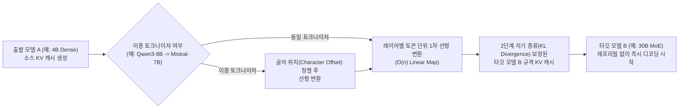

# KV-Lingo: 이종 LLM 라우팅의 재프리필 병목을 제거하는 선형 KV 캐시 직접 번역 아키텍처

## 1. 핵심 요약 (Executive Summary)
**KV-Lingo**(*Learning KV-Cache Translators with Distillation*, arXiv:2610.03692)는 Apple 연구진이 발표한 **이종(Heterogeneous) LLM 간 KV 캐시 직접 변환 프레임워크**다. 작업 난이도에 따라 모델을 동적으로 바꾸는 모델 라우팅(Model Routing)이나 MoA(Mixture of Agents)에서 모델을 전환할 때마다 이전 대화 문맥 전체를 처음부터 다시 인코딩해야 했던 **재프리필의 저주($O(n^2)$ Re-prefill Bottleneck)**를 **레이어별 1차 선형 행렬(Linear Map, $O(n)$)과 2단계 자기 증류(Self-Distillation)**로 해결했다.

이를 통해 H100 GPU 32K 장문 문맥에서 **첫 토큰 응답 시간(TTFT)을 29배 단축**하고, Apple M3 Ultra 온디바이스 환경에서 4B Dense 모델이 읽은 문맥을 30B MoE 모델로 넘겨 디코딩할 때 **TTFT를 152ms에서 15.8ms로 9.6배 단축**했다.

---

## 2. 등장 배경: 왜 모델 라우팅과 MoA가 실무에서 거대 단일 모델에 패배했는가?

1. **재프리필(Re-prefill) 병목**: 모델 A가 1만~3만 토큰의 문맥을 이미 처리했더라도, 고난도 단계에서 모델 B로 라우팅하는 순간 모델마다 히든 차원·레이어 수·어텐션 헤드 구조가 달라 KV 캐시를 공유할 수 없으므로 모델 B가 전체 문맥을 처음부터 다시 프리필해야 했다.
2. **$O(n^2)$ 지연 시간 역설**: 문맥 재인코딩 연산량은 길이의 제곱($O(n^2)$)에 비례하므로 모델 전환 시마다 수 초씩 화면이 멈추며, 결과적으로 소형+대형 모델을 섞어 쓰는 것보다 처음부터 대형 단일 모델 하나만 계속 쓰는 편이 더 빠르고 저렴해지는 역설이 발생했다.

---

## 3. 핵심 아키텍처 및 2단계 학습 파이프라인

### 3.1 왜 복잡한 신경망(MLP) 대신 단순 1차 선형 행렬(Linear Map)인가?
- **이미 선형에 가까운 모델 간 표현 기하학**: 서로 다른 LLM들의 내부 레이어 표현 공간(Representation Geometry)을 분석한 결과, 레이어 간 선형 상관관계가 이미 매우 높았다. 비선형 MLP를 도입해도 단순 선형 회귀 대비 설명력 차이가 **1~7%**에 불과했다.
- **$O(n)$ 연산 복잡도**: 레이어별 토큰 단위의 1차 선형 행렬 변환만 사용하므로 변환 연산량이 토큰 수에 정비례($O(n)$)하며, $O(n^2)$ 재프리필 대비 연산 오버헤드가 사실상 사라진다.

### 3.2 핵심 발견: 단순 수치 오차(MSE) 복원의 실패와 2단계 자기 증류(Self-Distillation)
연구진이 규명한 가장 중요한 공학적 함정은 **"캐시 텐서의 숫자 오차(MSE)만 줄여서는 모델이 정상적인 문장을 생성하지 못한다"**는 점이다.
1. **1단계 — 닫힌 형태(Closed-form) 선형 초기화의 한계**: 선형 회귀로 소스 캐시와 타깃 캐시 간의 수치 오차(MSE)만 최소화한 상태에서는 타깃 모델의 다운스트림 생성 성능이 바닥으로 추락한다.
2. **2단계 — 확률 분포 일치 자기 증류 (KL Divergence Self-Distillation)**: 반드시 타깃 모델이 **자신의 원본 캐시로 출력할 다음 단어 확률 분포**와 **번역된 캐시를 보고 출력할 확률 분포** 간의 **KL Divergence**를 최소화하는 2단계 자기 증류를 거쳐야 한다. 이 단계를 거치면 타깃 모델의 본래 생성 성능이 온전히 복원된다.

### 3.3 이종 토크나이저 정렬 및 멀티턴 누적 오차 방지
- **이종 토크나이저 호환 (Character Offset Alignment)**: `Qwen3-8B`와 `Mistral-7B`처럼 아키텍처와 어휘 사전(Tokenizer)이 완전히 다른 모델 사이에서도 **글자 위치(Character Offset)**를 기준으로 토큰 경계를 정렬하여 KV 캐시 직접 번역에 성공했다.
- **멀티턴 증분 번역 (Incremental Delta Translation)**: 다중 턴 대화에서 모델을 번갈아 사용할 때 매번 전체 대화를 다시 번역하면 오차가 누적되어 무너진다. 대신 **직전 턴에 새로 생성된 구간(Delta)만 번역해 기존 캐시에 이어붙이는 방식**을 적용하여 **10턴 이상 연속 모델 전환 시에도 성능 저하 0**을 달성했다.

---

## 4. 정량적 성능 검증 및 현재 한계점

| 실행 환경 및 시나리오 | 문맥 길이 | 기존 재프리필 대비 **TTFT 가속 배율** | 상세 수치 및 비고 |
| :--- | :--- | :--- | :--- |
| **NVIDIA H100 GPU (서버 라우팅)** | 2K 토큰 | **4.8x 가속** | 중문 문맥 즉시 전환 |
| **NVIDIA H100 GPU (장문 라우팅)** | **32K 토큰** | **29.0x 가속** | 장문 $O(n^2)$ 재프리필 제거 효과 극대화 |
| **Apple M3 Ultra (온디바이스 하이브리드)** | 64 토큰 (`4B Dense → 30B MoE`) | **9.6x 가속** | 응답 시작 시간 **152ms → 15.8ms** 단축 (경량 모델 프리필 + 대형 MoE 디코딩) |

### 4.1 솔직한 한계와 설계 시 주의사항
1. **학습 길이 외삽 한계 (16K → 32K+ RULER 저하)**: 변환기 학습 범위(16K)를 크게 초과하는 32K 이상 초장문에서는 미세한 변환 오차가 누적되어 정밀 바늘 찾기(RULER) 검색 성능이 하락한다.
2. **이종 계열 모델 간 성능 상한**: 아키텍처와 토크나이저가 완전히 다른 타사 모델 간 변환에서는 대형 모델 본래 성능보다 소형 소스 모델 수준으로 수렴하는 경향이 있으며, **모델 쌍(Pair)마다 전용 변환 행렬을 사전 학습**해 두어야 한다.
3. **차세대 방향성**: 향후 멀티 모델 패밀리를 설계할 때 처음부터 **공용 KV 캐시 인터페이스(Shared KV Interface)**를 염두에 두고 공동 훈련하면 완벽한 무손실 실시간 사고 공유가 가능하다.

---

## 5. 관련 문서 (Cross-References)
- [[wiki/Models/Optimization/LLM-Query-Routing-and-LLMRouter.md]]
- [[wiki/Models/Optimization/Colibri-Local-MoE-Inference-Engine.md]]
- [[wiki/Models/Optimization-and-Serving/스마트폰-환경의-LLM-서빙-기술-2026.md]]
- [[wiki/Models/Optimization-and-Serving/000_Optimization-and-Serving-MOC.md]]
