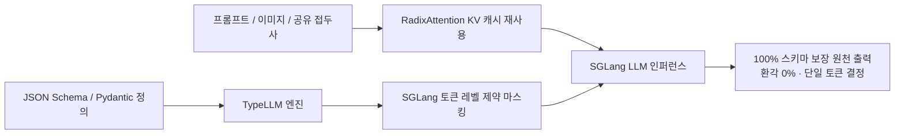
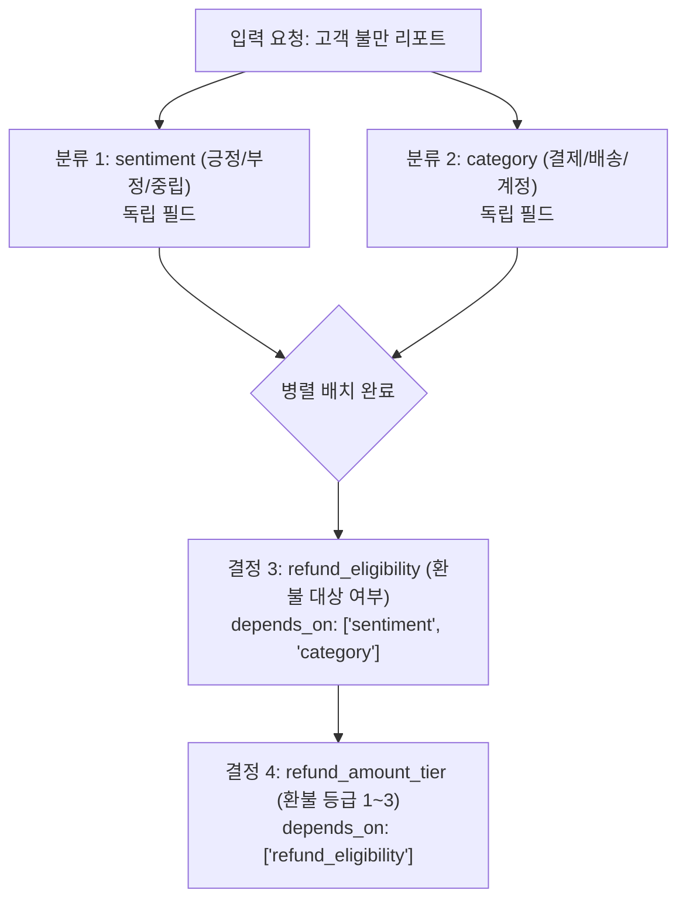

# TypeLLM: SGLang 기반 타입 안정(Type-Safe) 생성 및 스키마 의존성 디코딩

## 1. 개요 및 패러다임

기존의 대형 언어 모델(LLM)에 정형화된 JSON이나 특정 데이터 형식을 출력하도록 요청할 때, 프롬프트 엔지니어링이나 재시도(Retry) 루프에 의존하는 방식은 포맷 환각(Out-of-schema Hallucinations), 긴 토큰 생성 지연 시간, 그리고 파싱 오류로 인한 시스템 중단을 유발한다.

**TypeLLM**은 TypeSafe AI의 Jev 철학에 영감을 받아 개발된 오픈소스 프레임워크로, **기존 자기회귀(Autoregressive) LLM의 가중치나 모델 아키텍처를 변경하지 않고**, 고성능 추론 엔진인 **SGLang** 상에서 완벽한 **타입 안정(Type-Safe) 생성**을 실현한다.



---

## 2. TypeLLM의 7대 핵심 특징

1. **스키마 이탈 환각 완전 차단 (No Out-of-Schema Hallucinations)**:
   - 디코딩 단계에서 JSON Schema 문법에 부합하지 않는 모든 어휘(Vocab) 토큰의 로짓을 음의 무한대($-\infty$)로 마스킹하여 허용된 값 이외의 출력을 원천 봉쇄한다.
2. **출력 토큰 비용의 최소화 (Negligible Token Overhead)**:
   - 범주형 선택(Categorical Enum)은 단일 토큰으로 선택되며, 숫자 범위는 상하한 바운디드 디코딩(Bounded Numeric Decoding)으로 직접 수렴한다.
3. **공유 접두사 재사용 (Shared-Prefix KV Cache Reuse)**:
   - SGLang의 핵심 강점인 RadixAttention 기반 KV 캐시 트리 구조를 그대로 활용하여, 다중 결정 간 공통 시스템 프롬프트 및 문서 문맥을 재연산 없이 즉각 재사용한다.
4. **의존성 인식 실행 (Dependency-Aware Execution DAG)**:
   - 필드 간 인과 관계를 `depends_on` 데코레이터로 선언하여, 독립적인 필드는 병렬 배치로 추론하고 의존 필드는 이전 결과가 확정된 후 순차 실행하는 DAG(유향 비순환 그래프) 파이프라인을 지원한다.
5. **사고 모드(Thinking Mode) 유연성 결합**:
   - 최종 제약 출력을 생성하기 전에 모델의 네이티브 자유 추론(Chain-of-Thought / `<think>`)을 허용한 후 확정 단계에서만 엄격한 스키마를 강제할 수 있다.
6. **멀티모달 이미지 입력 지원 (Vision-Language Support)**:
   - 텍스트 컨텍스트뿐만 아니라 VLM(Qwen-VL, Pixtral 등)의 고해상도 이미지 입력을 함께 수용하여 시각적 검사 결과의 정형 출력을 보장한다.
7. **순열 평균화 (Permutation Averaging)**:
   - 다중 선택지(Enum) 평가 시 LLM이 첫 번째나 마지막 옵션을 편향되게 선호하는 위치 편향(Option-Order Bias)을 완화하기 위해, 선택지 순서를 무작위 샘플링하거나 전수 치환하여 로짓을 앙상블한다.

---

## 3. 의존성 인식(Dependency-Aware) 실행 아키텍처



위 구조에서 `sentiment`와 `category`는 첫 번째 인퍼런스 패스에서 단일 배치로 동시 디코딩되며, 그 결과를 KV 캐시에 이어 붙인 뒤 후속 의존 필드들이 순차 확정된다.

---

## 4. 파이썬 실전 구현 예제

### 4.1. 스키마 정의 및 의존성 그래프 선언

```python
from typellm import TypeLLM, Field, SchemaDAG
from typing import Literal

# 의존성 그래프를 포함하는 스키마 모델 선언
class CustomerTriageSchema(SchemaDAG):
    # 1. 독립 필드 (배치 병렬 평가)
    issue_type: Literal["billing_error", "delivery_delay", "feature_request"] = Field(
        description="고객 문의의 1차 분류 유형"
    )
    urgency_level: Literal["low", "medium", "high", "critical"] = Field(
        description="긴급도 수준 평가"
    )
    
    # 2. 의존 필드 (앞선 필드 결과가 결정된 후 실행)
    compensation_required: bool = Field(
        description="보상금 또는 환불 지급 필요 여부",
        depends_on=["issue_type", "urgency_level"]
    )
    
    action_route: Literal["auto_refund", "support_ticket", "engineering_jira"] = Field(
        description="최종 라우팅 목적지",
        depends_on=["compensation_required"]
    )

# 4.2. SGLang 엔드포인트 연동 및 실행
engine = TypeLLM(
    model="Qwen/Qwen2.5-72B-Instruct",
    backend="sglang",
    api_url="http://localhost:30000",
    enable_thinking=True,         # 제약 전 CoT 허용
    permutation_averaging=True    # 선택지 순서 편향 보정
)

user_context = """
고객 ID: 94812
인입 메시지: '어제 결제했는데 주문 내역에 반영이 안 되고 계좌에서만 50,000원이 두 번 빠져나갔습니다. 당장 취소해주세요.'
"""

# 스키마 보장 단일 실행
result = engine.generate(
    prompt=user_context,
    schema=CustomerTriageSchema
)

print(result.to_dict())
# 출력 결과:
# {
#   "issue_type": "billing_error",
#   "urgency_level": "critical",
#   "compensation_required": True,
#   "action_route": "auto_refund"
# }
```

---

## 5. 프레임워크 간 비교

| 비교 항목 | Outlines / Instructor | SGLang 기본 정규식 | TypeLLM (2026) |
| :--- | :--- | :--- | :--- |
| **추론 백엔드** | vLLM / llama.cpp / HF | SGLang 네이티브 | **SGLang 전용 극대화** |
| **KV 캐시 재사용** | 제한적 | RadixAttention 활용 | **의존성 단계별 자동 KV 누적** |
| **의존성 DAG 지원** | 수동 체이닝 필요 | 미지원 | **`depends_on` 자동 토폴로지 정렬** |
| **선택지 순서 편향** | 모델 편향 노출 | 미처리 | **순열 평균화 (Permutation Avg)** |
| **추론 사고(Thinking)** | JSON 형식 깨짐 위험 | 제약 전 분리 까다로움 | **네이티브 Thinking 모드 격리** |

---

## 6. 에이전트 인프라와의 결합

1. **도구 인자(Tool Arguments) 확정**:
   - 자율 에이전트([[wiki/Engineering/AI-Native-Engineering/Agentic-Software-Factory.md]])가 샌드박스 CLI 도구를 실행할 때, 인자 누락이나 잘못된 플래그 입력으로 인한 실행 실패를 사전에 차단.
2. **초고속 결정 계층 하이브리드 구성**:
   - `[[wiki/Models/Optimization-and-Serving/CLM-Choice-Language-Model.md]]`로 15ms 단일 라우팅을 수행하고, 다중 인자가 필요한 복합 페이로드는 TypeLLM으로 위임하는 2계층 구조 확립.

---

## 🔗 관련 문서 링크
- [[wiki/Models/Optimization-and-Serving/CLM-Choice-Language-Model.md]] — Stanford + NVIDIA 오픈소스 선택 언어 모델
- [[wiki/Agents/Frameworks/TypeSafe-Jev-System-One-Decision-Architecture.md]] — TypeSafe Jev 결정 전용 모델
- [[wiki/Models/Optimization-and-Serving/GLiNER2.5-Decide-Structured-Decision-Encoder.md]] — 스팬/관계 및 제약 조건 처리 인코더 결정 모델
- [[wiki/Engineering/AI-Native-Engineering/Agentic-Software-Factory.md]] — 에이전트 네이티브 소프트웨어 팩토리
- [[wiki/Models/Optimization-and-Serving/000_Optimization-and-Serving-MOC.md]] — 모델 최적화 및 서빙 색인
