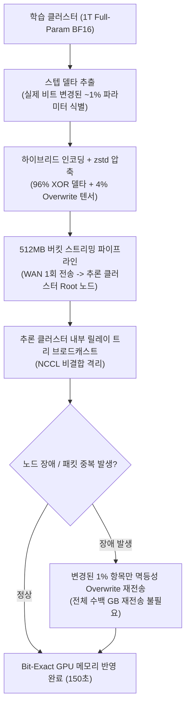

# NeMo-DCR: 1조 파라미터 에이전틱 강화학습을 위한 비트 무손실 델타 압축 가중치 동기화

## 1. 핵심 요약 (Executive Summary)
**NeMo-DCR**(*Bit-Exact Delta-Compressed Refit for Scalable Agentic RL at Trillion-Parameter Scale*)은 NVIDIA 연구진이 발표하고 `NeMo RL`에 통합한 대규모 강화학습 가중치 동기화(Refit) 아키텍처다. 1조(1T) 파라미터 모델의 에이전틱 RL 학습 시 학습 클러스터에서 추론(Rollout) 클러스터로 가중치를 복사하는 데 걸리던 **87.5분의 병목을 단 2.5분(150초, 35배 단축)**으로 줄이면서도 **1비트도 오차가 없는 완전 무손실(Bit-Exact) 학습 궤적**을 달성했다.

---

## 2. 문제 정의: 에이전틱 RL의 가중치 Refit 병목과 Full-Parameter 필수성

### 2.1 왜 매 스텝 1%만 변하는데 100%를 전송하고 있었는가?
- 에이전틱 RL에서는 전체 학습 시간의 **70% 이상이 롤아웃(추론 및 환경 상호작용)**에 소비되므로 학습 서버 클러스터와 추론 서버 클러스터를 분리 운영한다.
- 매 학습 스텝 종료 시 업데이트된 가중치를 추론 서버로 전달(Refit)해야 다음 배치를 생성할 수 있다.
- 연구진이 BF16 풀 파라미터 RL 과정을 실측한 결과, 옵티마이저가 1스텝 업데이트를 수행해도 부동소수점 반올림 경계를 넘지 못해 **실제 저장 비트가 변경되는 가중치는 전체의 `0.6% ~ 1.2%`(약 1%)**에 불과했다.

### 2.2 왜 LoRA RL로 대체할 수 없는가?
- 이미 RL이 완료된 추론 모델을 특정 도메인에 미세 교정할 때는 LoRA RL로 충분하지만, **SFT만 마친 베이스 모델이 처음 RL을 통해 자가 추론(System 2) 능력을 깨우치기 위해서는 전체 지식을 재배치하는 풀 파라미터(Full-Parameter) RL이 필수적**이다.
- NeMo-DCR은 풀 파라미터 표현력을 그대로 유지하면서, 허깅페이스 표준 규격 위치 기반으로 실제 비트가 변한 1% 파라미터만 추출·압축하여 LoRA 수준의 초경량 전송을 구현한다.

---

## 3. 핵심 아키텍처 및 엔지니어링 메커니즘

### 3.1 평상시 XOR 압축(96%) + 특수 텐서 Overwrite(4%) 하이브리드
1. **XOR 상위 비트 제로화 압축 (96% 일반 텐서)**:
   - 가중치가 미세하게 변할 때 BF16의 상위 비트(부호·지수부)는 대부분 동일하게 유지된다.
   - 이전 값(`0x3F01`)과 새 값(`0x3F02`)을 XOR 연산하면 상위 14개 비트가 모두 `0`(`0x0003`)이 된다. 연속된 `0` 바이트는 `zstd` 무손실 압축 효율을 극대화하여 단순 새 값 전송 대비 전송 용량을 **38~40% 추가 절감**한다.
2. **특수 텐서 Overwrite (3~4%)**:
   - 스케일링 등으로 비트 구조가 크게 변형되는 3~4%의 특수 텐서는 평소에도 새 값 그대로 덮어쓰는 Overwrite 모드로 전송한다.

### 3.2 장애 복구: XOR 비멱등성 함정과 1% 멱등성 Overwrite 폴백
- **XOR의 치명적 약점**: XOR 연산은 동일 패킷이 네트워크 재시도로 두 번 적용되면 원래 옛날 값으로 되돌아가는 비멱등성($A \oplus B \oplus B = A$) 문제를 갖는다. 전송 도중 추론 노드가 재시작되어 이전 값과 새 값이 섞이면 XOR 패킷만으로는 복구가 불가능하다.
- **NeMo-DCR의 해법**: 노드 장애나 에러 발생 시 수백 GB~수 TB의 전체 모델 체크포인트를 다시 보내는 대신, **해당 스텝에서 변경되었던 1% 인덱스에 대해서만 XOR을 버리고 '바뀐 새 값 그대로'를 덮어쓰는 Overwrite 모드로 재전송**한다. 몇 번을 덮어써도 항상 최신 값으로 수렴하는 멱등성(Idempotency)을 이용해 엉킨 GPU 메모리를 즉시 복구한다.

### 3.3 NCCL 비결합 릴레이 트리(Relay Tree) 및 512MB 버킷 파이프라이닝
- **클러스터 간 장애 격리**: 학습 클러스터와 추론 클러스터를 단일 집합 통신(NCCL communicator)으로 직접 묶지 않아, 추론 노드 하나의 장애가 학습 클러스터 전체를 멈추지 않도록 격리했다.
- **WAN 릴레이 트리**: 느리고 비용이 높은 리전 간 광역망(WAN)을 건널 때는 추론 클러스터의 **대표(Root) 노드 단 1곳**으로만 패킷을 1회 전송하고, 대표 노드가 고속 내부 로컬 망을 통해 트리 구조로 나머지 추론 노드에 배포한다.
- **512MB 스트리밍 파이프라인**: 1T 모델 전체 비교가 끝날 때까지 기다리지 않고, **512MB 버킷**이 압축되는 즉시 네트워크로 전송하며 추론 서버는 도착 즉시 압축 해제 및 GPU 메모리 패치를 병렬 수행한다.

---

## 4. 벤치마크 성능 및 검증 결과

| 모델 규모 | 기존 전체 가중치 Refit 시간 | NeMo-DCR Refit 시간 | 단축 배율 | 정합성 및 내결함성 검증 |
| :--- | :--- | :--- | :--- | :--- |
| **120B 모델** | 750초 (12.5분) | **22.6초** | **33.2x 단축** | Bit-Exact (1비트 오차 없음) |
| **1T (1조) 모델** | 5,250초 (87.5분) | **150초 (2.5분)** | **35.0x 단축** | 5스텝마다 추론 서버 강제 종료 시에도 Bit-Exact 학습 궤적 유지 |

- **오픈소스 통합**: NVIDIA 공식 `NeMo RL` GitHub 리포지토리에 통합되어 대규모 에이전틱 RL 파이프라인에서 즉시 활성화할 수 있다.

---

## 5. 관련 문서 (Cross-References)
- [[wiki/Models/RL/Agent-R1 Training Powerful LLM Agents with End-to-End Reinforcement Learning.md]]
- [[wiki/Models/RL/Xiaomi-MiMo-Open-RL-Task-Environments.md]]
- [[wiki/Models/RL/DeepSeek-R1-GRPO-Implementation.md]]
- [[wiki/Models/RL/LMSYS-Miles-On-Policy-Distillation.md]]
- [[wiki/Models/RL/000_RL-MOC.md]]
