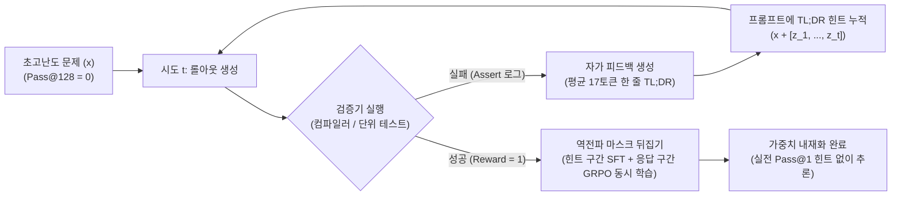

# RLTL;DR: 자가 생성 17토큰 오답노트 내재화 기반 초고난도 강화학습 프레임워크

## 1. 핵심 요약 (Executive Summary)
**RLTL;DR**(*Self-improvement by Internalizing Self-generated Feedback*)은 Apple 연구진이 제안한 강화학습(RLVR) 프레임워크로, 기존 병렬 롤아웃 기반 강화학습([[wiki/Models/RL/DeepSeek-R1-GRPO-Implementation.md|GRPO]])에서 **128회 연속 시도해도 정답률이 0%(`Pass@128 = 0`)인 초고난도 코딩·도구 호출 문제**를 외부 지도학습(SFT) 데이터나 거대 교사 모델 없이 **실전 힌트 부재 평가(`Pass@1`) 정답률 13%까지 끌어올린 자가 개선 학습 패러다임**이다.

핵심 메커니즘은 실패한 시도의 단위 테스트·컴파일러 에러 로그로부터 모델 스스로 **평균 17토큰 분량의 초단문 한 줄 교훈(TL;DR 오답노트)**을 추출해 순차적 재시도 프롬프트에 누적하고, 성공 시 **프롬프트 내 17토큰 힌트 구간의 역전파 그라디언트 마스크를 활성화(Gradient Mask Inversion)**하여 문제($x$)에서 핵심 주의사항($z$)을 거쳐 정답($y$)에 도달하는 경로를 모델 가중치에 직접 내재화하는 것이다.

---

## 2. 등장 배경: `Pass@128 = 0` 구간의 그라디언트 소멸 병목
1. **병렬 탐색(GRPO)의 한계**: 표준 GRPO는 동일 프롬프트에 대해 $G$개의 응답을 독립적으로 병렬 생성한 뒤 그룹 내 상대 보상을 계산한다. 그러나 모든 롤아웃이 보상을 받지 못하는(`Reward = 0`) 초고난도 문제에서는 분산이 0이 되어 그라디언트가 완전히 사라지고 학습이 정지한다.
2. **실패 원인의 본질 (지능 부족 vs 지엽적 사각지대)**: 연구진의 오류 분석 결과, 베이스 모델(Qwen3.5-9B)이 문제를 풀지 못한 이유는 근본적 추론 능력 부재 때문만이 아니라, 대소문자 표기 오류(`orange` vs `Orange`, 15.3%)나 상태 변경 API 호출 누락(단순 조회 후 읽음 처리 함수 미호출, 11.8%) 등 사소한 사각지대에 반복적으로 걸려 넘어지기 때문임이 밝혀졌다.
3. **순차적 힌트 누적의 위력**: 힌트 없이 16회 독립 시도할 때 6%에 불과하던 해결률이, 직전 실패에서 뽑아낸 한 줄 교훈(최대 16개)을 프롬프트에 순차 누적하자 가중치 학습 전 베이스 모델(Qwen3.5-9B) 상태에서도 **57%**까지 급등했다.

---

## 3. 시스템 아키텍처 및 핵심 메커니즘



### 3.1 순차적 탐색 및 17토큰 자가 피드백 (TL;DR Self-Feedback)
- 시도 $t$가 실패하면 모델은 방금 생성한 오답 궤적과 검증기(단위 테스트/컴파일러)의 에러 메시지를 입력받아 *"글을 단순 조회만 하지 말고 반드시 읽음 처리 API를 호출해야 함"*과 같은 **한 문장 교훈(평균 17토큰)**을 생성한다.
- 다음 시도 $t+1$에서는 원본 문제 프롬프트 끝에 지금까지 수집된 한 줄 힌트 리스트 $[z_1, z_2, \dots, z_t]$를 덧붙여 다시 풀게 한다.

### 3.2 프롬프트 힌트 역전파 마스크 뒤집기 (Prompt Gradient Mask Inversion)
프롬프트에 적힌 힌트를 보고 문제를 풀더라도, 실전 평가(`Pass@1`)에서는 아무런 힌트가 주어지지 않으므로 힌트 생성 능력 자체를 가중치에 내재화해야 한다.
- **기존 RL의 한계**: 일반 강화학습에서는 입력 프롬프트 토큰 구간의 손실 마스크(Loss Mask)를 `0`으로 설정하여 프롬프트 구간에는 역전파를 수행하지 않는다.
- **RLTL;DR의 해법**: 성공한 롤아웃이 나오면 실시간 RL 업데이트 루프 안에서 **응답 영역에는 강화학습 손실(GRPO)**을 걸고, **프롬프트 안에 삽입되어 있던 17토큰짜리 힌트 구간($z$)의 그라디언트 마스크만 `1`로 뒤집어 다음 토큰 예측(SFT) 손실을 동시에 부과**한다.

```python
# RLTL;DR 결합 손실 및 프롬프트 힌트 마스크 활성화 의사코드
def compute_rltldr_loss(input_ids, prompt_len, hint_span, advantage, logits, old_logprobs):
    # 1. 응답 구간: 표준 GRPO 정책 그라디언트 손실
    response_mask = (torch.arange(input_ids.size(1)) >= prompt_len).float()
    grpo_loss = compute_grpo_loss(logits, input_ids, advantage, old_logprobs, mask=response_mask)

    # 2. 프롬프트 내 17토큰 힌트 구간(hint_span): 마스크를 1로 켜서 SFT(Next-Token Prediction) 손실 계산
    hint_mask = torch.zeros_like(input_ids, dtype=torch.float)
    hint_mask[:, hint_span.start:hint_span.end] = 1.0
    sft_loss = cross_entropy_loss(logits[:, :-1], input_ids[:, 1:], mask=hint_mask[:, 1:])

    # 추가 롤아웃 연산 없이 단일 패스에서 문제 -> 교훈 -> 정답 매핑을 내재화
    return grpo_loss + lambda_sft * sft_loss
```

---

## 4. 핵심 실험 인사이트 및 엔지니어링 설계 원칙

| 실험 비교 축 | 설정 A | 설정 B | 실전 `Pass@1` 결과 | 핵심 인사이트 |
| :--- | :--- | :--- | :--- | :--- |
| **기본 성능 (초고난도군)** | 기존 GRPO (`Pass@128=0`) | **RLTL;DR (17토큰 내재화)** | `0~1%` → **`12~13%`** | 보상 0의 늪을 외부 데이터 없이 돌파 |
| **피드백 생성 모델 체급** | 9B 학생 모델 자체 생성 | 거대 교사 모델([[wiki/Models/Architectures/GLM-5-2-Architecture-and-IndexShare.md|GLM-5.2]]) | `19.2%` → `20.2%` (+1.0%p) | **훈수꾼의 체급보다 검증기 로그 유무가 결정적** |
| **검증기 에러 로그 유무** | 단위 테스트 Assert 에러 포함 | 성공/실패(Binary)만 제공 | **`21.4%`** → `3.4%` (폭락) | 정확한 컴파일러/테스트 에러 단서가 필수 |
| **피드백 길이 (과유불급)** | **17토큰 한 줄 요약 (TL;DR)** | 상세 원인 분석 + 수정 코드 포함 | **`21.4%`** → `13.8~15.7%` | 긴 코드는 일회성 ID·토큰 노이즈로 일반화 저해 |

1. **거대 교사 모델보다 정확한 실행 검증기(Verifier)가 핵심이다**: 피드백 작성 모델을 9B에서 거대 모델(GLM-5.2)로 교체해도 향상폭은 미미(+1.0%p)했으나, 단위 테스트의 `Assert` 실패 로그를 가리고 통과 여부만 제공하자 정답률이 `21.4%`에서 `3.4%`로 폭락했다.
2. **요약의 간결성이 일반화 성능을 결정한다 (Short Abstracts Generalize Better)**: 상세한 설명과 수정 코드를 프롬프트에 넣으면 당장 힌트를 보고 푸는 인컨텍스트 성공률은 +41.1% 오르지만, 힌트를 제거한 실전 `Pass@1` 정답률은 오히려 `13.8~15.7%`로 하락한다. 구체적 코드 조각에는 해당 문제에만 등장하는 상품 ID·세션 변수 등 지엽적 노이즈가 포함되어 타 문제로의 전이를 방해하기 때문이다.

---

## 5. 관련 문서 (Cross-References)
- [[wiki/Models/RL/DeepSeek-R1-GRPO-Implementation.md]]
- [[wiki/Models/RL/Self-Play-Pretraining-Zero-Data.md]]
- [[wiki/Models/RL/Post-Training-OPD-and-Sparse-Reward-Dynamics-2026.md]]
- [[wiki/Models/RL/Agent-R1 Training Powerful LLM Agents with End-to-End Reinforcement Learning.md]]
- [[wiki/Agents/Self-Evolving/WikiSkill-절차적-지식-자가-진화-프레임워크.md]]
- [[wiki/Models/RL/000_RL-MOC.md]]
