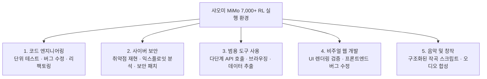
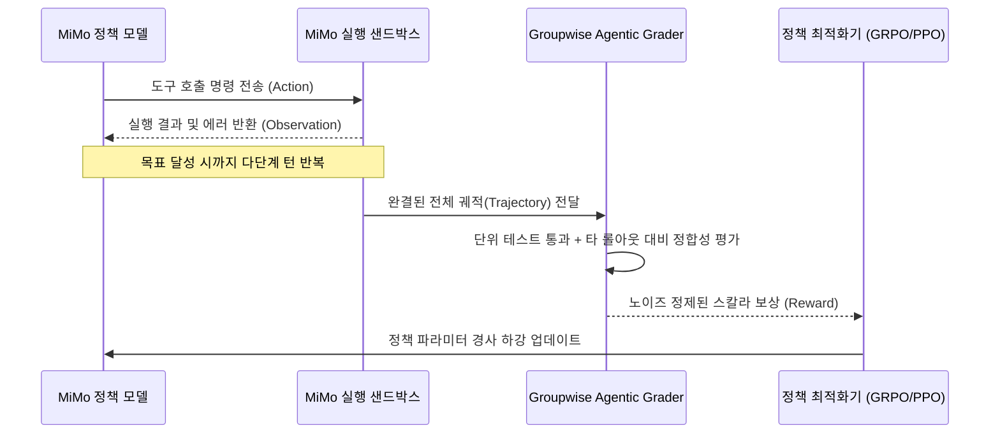

# 샤오미 MiMo: 7,000개 이상의 오픈소스 강화학습(RL) 실행 환경 및 자가 개선 훈련 파이프라인

## 1. 패러다임 전환: 오픈 가중치에서 오픈 학습 환경으로

대형 언어 모델의 발전 과정에서 모델 가중치(Open Weights) 공개는 누구나 모델을 추론할 수 있게 했지만, 그 모델을 어떻게 가르치고 개선할 것인가에 대한 **학습 환경(Learning Environment)**은 대부분 빅테크의 사내 인프라로 격리되어 있었다.

2026년 9월, **샤오미(Xiaomi AI Lab)**는 자사의 최신 파운데이션 모델 **MiMo-V2.6** 훈련에 사용된 **7,000개 이상의 강화학습 태스크 환경(MiMo-RL)**, 전체 훈련 코드, 보상 메타데이터, 그리고 훈련 궤적(Trajectories)을 MIT 라이선스 기반의 완전 오픈소스로 공개하였다 (`XiaomiMiMo/MiMo-V2.6-RL-oss`).

```
[기존 패러다임]
정적 정답 데이터셋 (Dataset) ────► 단순 모방 학습 (SFT) ────► 정적 답변 암기

[MiMo 패러다임]
실행 가능한 환경 (7,000+ Envs) ──► 시행착오 및 행동 (Actions) ──► 환경 피드백 및 보상 ──► 능동적 정책 최적화 (RL)
```

---

## 2. 5대 핵심 도메인 및 환경 아키텍처

MiMo-RL 환경군은 에이전트가 현실 세계에서 마주하는 복잡한 태스크를 모사하는 5대 핵심 도메인으로 구성된다:



### 환경의 4대 구성 요소
1. **실행 가능한 세계 (Executable World)**: 도커/샌드박스 기반의 격리된 런타임으로 파일시스템, 컴파일러, 네트워크, 브라우저가 완비됨.
2. **명확한 목표 명세 (Objective Prompts)**: 에이전트가 완수해야 할 목표를 기술한 자연어 지시문.
3. **사용 가능한 도구 셋 (Agent Tools)**: Bash 실행, 파일 편집, 웹 검색, Git 조작 등 도구 인터페이스.
4. **신뢰할 수 있는 성공 판정기 (Test Oracles & Reward Metadata)**: 코드 실행 결과, AST 분석, 유닛 테스트 통과 여부로 보상을 산출하는 객관적 보상 함수.

---

## 3. 대규모 RL 훈련 루프 및 기법

### 3.1. 훈련 스케일과 궤적 표현
- **스텝당 궤적 수**: 최적화 스텝당 약 **25,000개 궤적(Trajectories)**을 수집.
- **배치 규모**: 프롬프트당 16개 롤아웃을 실행하여 스텝당 **27억~37억(2.7B~3.7B) 토큰** 규모의 대규모 RL 업데이트 수행.
- **통합 궤적 포맷 (Unified Trajectory Representation)**:
  - 모델의 사고 과정(Reasoning CoT)
  - 호출된 도구 명세 및 인자(Tool Calls)
  - 환경으로부터 반환된 관측값(Observations/Feedback)
  - 최종 및 단계별 보상(Rewards)

### 3.2. 보상 해킹 방지: 그룹 단위 에이전틱 채점 (Groupwise Agentic Grading)
정적 키워드 매칭이나 단순 길이 기반 보상은 보상 해킹(Reward Hacking)을 유발하므로, MiMo 팀은 프롬프트 그룹 내 롤아웃들을 종합 대조 평가하는 **Groupwise Agentic Grading** 기법을 적용하여 허위 보상(Spurious Advantage)을 차단하였다.



---

## 4. 오픈소스 환경이 제공하는 실무적 효용

1. **소형 특화 모델(Specialized SLM) 직접 양성**:
   - 70B 이상의 거대 모델에 의존하지 않고, 7B~14B 규모의 경량 오픈 모델(Qwen, Llama 등)에 특정 도메인(예: 소프트웨어 유지보수, 취약점 분석)의 MiMo 환경을 집중 학습시켜 엔터프라이즈 전용 에이전트 구축 가능.
2. **에이전트 실패 모드 심층 분석**:
   - 7,000개 환경에서 에이전트가 어느 단계에서 환각을 일으키는지, 도구 인자 파싱에서 실패하는지, 복구 루프에서 교착 상태에 빠지는지를 궤적 로그를 통해 역추적.
3. **훈련 알고리즘 간 벤치마킹**:
   - GRPO, GDPO, PPO 등 다양한 강화학습 알고리즘의 학습 수렴 속도와 샘플 효율성을 표준 환경 위에서 공정 비교.

---

## 5. 실전 환경 실행 코드 (Python 예제)

```python
import mimo_env

# 1. MiMo 코딩 태스크 환경 초기화
env = mimo_env.make("mimo-code-v2.6/repo-issue-reproduce-482")

# 2. 과제 목표 및 초기 관측값 획득
obs, info = env.reset()
print(f"과제 목표: {info['objective']}")
print(f"작업 디렉터리: {obs['cwd']}")

# 3. 에이전트 상호작용 루프
done = False
while not done:
    # 에이전트 추론 후 도구 액션 생성
    action = {
        "tool": "bash",
        "command": "pytest tests/test_parser.py"
    }
    obs, reward, done, truncated, info = env.step(action)
    print(f"실행 결과: {obs['stdout'][:200]}")
    print(f"현재 보상: {reward}")

if reward > 0.9:
    print(">> 태스크 성공: 단위 테스트 통과 및 버그 수정 검증 완료")
```

---

## 🔗 관련 문서 링크
- [[wiki/Models/RL/Agent-R1 Training Powerful LLM Agents with End-to-End Reinforcement Learning.md]] — 종단간 강화학습 기반 강력한 LLM 에이전트
- [[wiki/Models/RL/DeepSeek-R1-GRPO-Implementation.md]] — 비평가-프리 GRPO 강화학습 구현
- [[wiki/Models/RL/NVIDIA GDPO: 다중 보상 RL의 GRPO 결함 해결.md]] — 다중 보상 결합 최적화
- [[wiki/Models/RL/Self-Play-Pretraining-Zero-Data.md]] — 무데이터 자기대전 사전학습
- [[wiki/Models/RL/000_RL-MOC.md]] — 강화학습 MOC 색인
