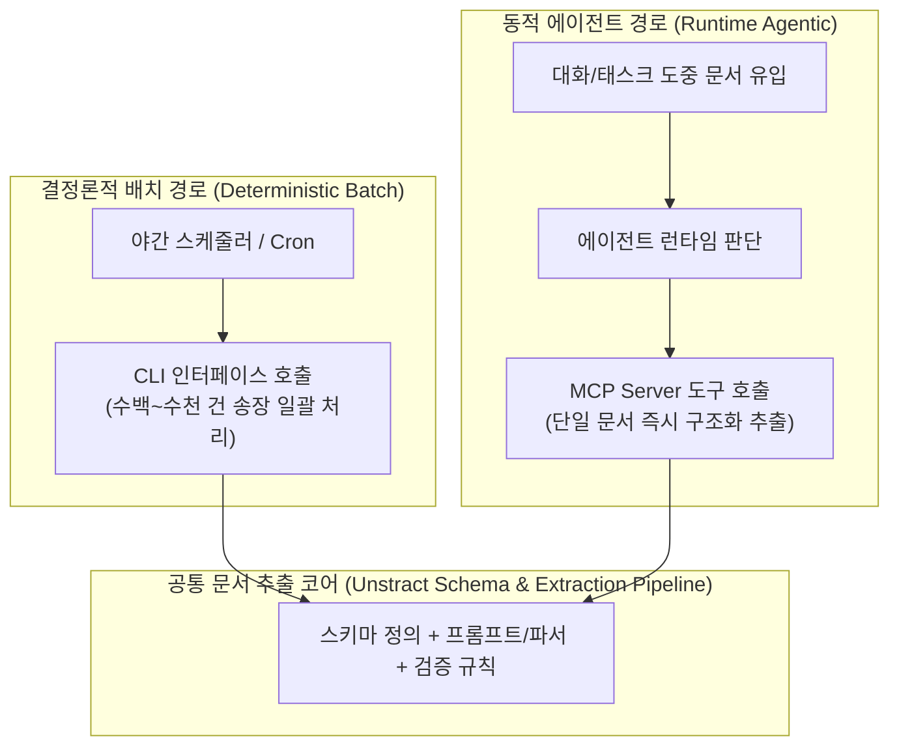

# 이중 인터페이스 문서 추출 파이프라인(CLI & MCP) 및 공개 MCP 서버 트래픽 제어 패턴

## 1. 핵심 요약 (Executive Summary)
엔터프라이즈 문서 추출(Document Extraction)과 연구 지식 조회 시스템에서 **단일 코어 파이프라인을 배치용 CLI와 에이전트 런타임용 MCP(Model Context Protocol) 이중 인터페이스로 노출하는 아키텍처 패턴**이 표준화되고 있다.
1. **Unstract 이중 인터페이스 패턴**: 정해진 야간 대량 송장·계약서 처리는 결정론적 **CLI 배치 작업**으로 실행하고, 대화 도중 동적으로 유입되는 단일 문서는 **MCP 도구 호출**을 통해 에이전트가 런타임에 즉시 추출하도록 동일한 추출 프로젝트를 재사용한다.
2. **공개 MCP 서버의 에이전트 루프 방어 패턴 (Papers with Code OSS 사례)**: Apache 2.0으로 오픈소스화된 신규 Papers with Code 모노레포(FastAPI + React + 공개 API + MCP 서버) 사례에서 확인되듯, 에이전트는 인간 웹 사용자와 달리 실패 시 무한 루프·고빈도 재시도(Retry Storm)를 유발하므로 **웹 프론트엔드 API와 분리된 MCP 전용 클라이언트별 속도 제한(Per-Client Rate Limit) 및 응답 페이로드 크기 상한(Hard Payload Cap)**이 필수적이다.

---

## 2. 단일 추출 엔진의 CLI 배치 vs 런타임 MCP 이중 노출 설계



### 2.1 실행 패턴에 따른 인터페이스 분리 원칙
| 비교 축 | CLI 인터페이스 (Batch Mode) | MCP 인터페이스 (Agent Runtime Mode) |
| :--- | :--- | :--- |
| **실행 시점 및 대상** | 처리할 문서 목록·추출 필드·실행 시각이 사전에 확정됨 | 태스크 수행 도중 문서가 동적으로 등장하며 에이전트가 추출 여부를 결정 |
| **주요 워크로드** | 야간 수백 건의 송장(Invoice)·계약서 정기 배치 파이프라인 | 사용자 대화 중 첨부된 단일 명세서에서 특정 필드만 즉시 추출 후 후속 도구 호출 |
| **코어 로직 재사용** | **동일한 추출 프로젝트(스키마·프롬프트·검증기) 공유** | **동일한 추출 프로젝트 공유** (호출 어댑터만 MCP로 래핑) |

---

## 3. 공개 API + MCP 서버 호스팅 시 트래픽 격리 가드레일

오픈소스로 공개된 **Papers with Code** 아키텍처(Python FastAPI 백엔드 + React 프론트엔드 + 공개 REST API + MCP 서버를 단일 Hetzner VPS 모노레포로 호스팅)는 에이전트용 MCP 엔드포인트 운영 시 발생하는 핵심 인프라 위험을 보여준다.

### 3.1 에이전트 트래픽 프로파일의 비대칭성
- **인간 프론트엔드 트래픽**: 페이지네이션과 클릭 간격이 존재하며 에러 발생 시 즉시 멈춘다.
- **에이전트 MCP 트래픽**: 파싱 오류나 모호한 검색 결과가 반환되면 에이전트가 자율 루프 안에서 초당 수십 회 재시도(Retry Loop)하거나 전체 테이블 덤프를 요청하여 단일 VPS의 CPU·DB 커넥션 풀을 고갈시키고 웹 프론트엔드까지 다운시킨다.

### 3.2 MCP 엔드포인트 필수 방어 설정 (FastAPI 예시)
```python
# 웹 프론트엔드 API와 MCP 엔드포인트의 Rate Limit 및 결과 크기 상한 분리 패턴
from fastapi import FastAPI, Request, HTTPException

MAX_MCP_ITEMS = 25          # 에이전트 컨텍스트 폭탄 및 서버 고갈 방지용 하드 캡
MCP_RATE_LIMIT_PER_MIN = 30 # 클라이언트(API Key / IP)당 분당 호출 상한

@app.post("/mcp/tools/search_papers")
async def mcp_search_papers(query: str, limit: int = 10, request: Request = None):
    client_id = request.headers.get("X-Client-ID") or request.client.host
    if not rate_limiter.allow(bucket=f"mcp:{client_id}", rpm=MCP_RATE_LIMIT_PER_MIN):
        raise HTTPException(status_code=429, detail="MCP rate limit exceeded; backoff required.")
    
    capped_limit = min(limit, MAX_MCP_ITEMS)
    results = await db.search_papers(query=query, limit=capped_limit)
    return {"items": results, "truncated": limit > MAX_MCP_ITEMS}
```

---

## 4. 관련 문서 (Cross-References)
- [[wiki/RAG/SOTA-OCR-및-문서-정규화-기술.md]]
- [[wiki/Agents/Frameworks/OpenResearch-Local-First-Autoresearch-Workspace.md]]
- [[wiki/Agents/Implementation/Agent-Infrastructure-12-Core-Design-Patterns.md]]
- [[wiki/Engineering/AI-Native-Engineering/Agent-SSE-Failfast-and-Tool-Flood-Guard.md]]
- [[wiki/RAG/000_RAG-MOC.md]]
